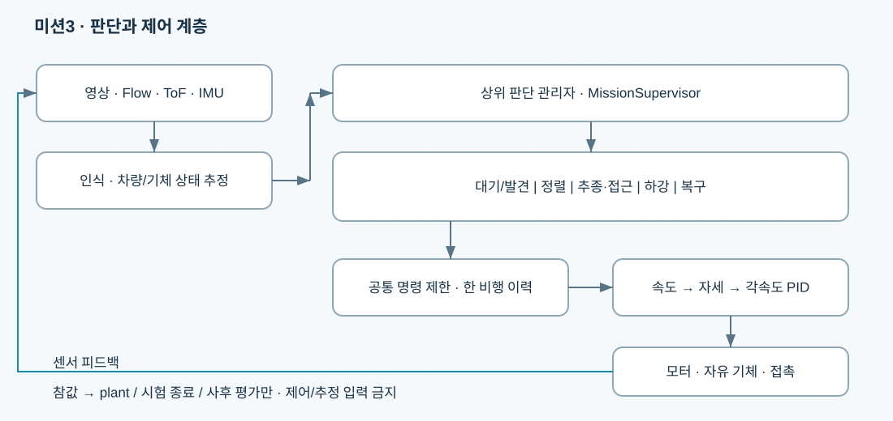

# Drone3

## 미션3 현재 기준 — 2026-10-09

Crazyflie 2.1 + AI-deck + Flow deck를 대상으로, PC에서 ArUco 인식과 상위 제어 명령을 계산하는 시뮬레이션 프로젝트입니다.

최신 시험은 **30×5m 경기장 / 동쪽 28m 직선 / 차량 최고 0.3m/s / 1m 호버 준비 후 차량 출발**입니다.
드론은 북쪽에서 동쪽으로 20°를 바라보며 고정 대기하고, 영상에서 마커를 발견하면 정렬·추종·접근·하강합니다.
판 20×20cm / 코드 15×15cm / 패드 20×20cm / 패드 높이 30cm를 사용합니다.

| 먼저 볼 자료 | 내용 |
|---|---|
| [팀원 PC 설치·실행](docs/mission3/teammate-setup.md) | 팀장 저장소를 설치한 PC에서 미션3 재현 |
| [팀 공유 보고서 PDF](docs/mission3/mission3-team-share-20261009.pdf) | 전체 제어 구조·환경·최신 16회 결과·검증 한계 |
| [상위 판단과 하위 제어 구조](docs/mission3/hierarchical-control-20261009.md) | `MissionSupervisor`와 단계 제어 모듈 |
| [직선 경기장·자동 실행 안내](docs/mission3/straight-arena-automation-20261009.md) | 배치·차량 출발·GUI·병렬 시험 |
| [최신 직선 시험 16회 자료](results/mission3/straight-20261009/README.md) | 전체 결과표·판정 증거·원자료 SHA |
| [Git 공유 구성](docs/git-sharing.md) | 추적할 코드·자료와 대용량 Release 첨부 구분 |

판단 관리자 → 대기/인식 → 정렬 → 접근/추종 → 하강/착지 단계로 구성합니다.
영상·IMU·Flow/ToF의 추정값으로 차량 상태를 계산하고, 추정 차량 속도의 피드포워드와 상대 오차 피드백을 함께 사용합니다.
속도·가속도·yaw 포화 이력은 단계 전환 중에도 공유합니다.



최신 결과는 거리 1.25→0.50m를 5cm 간격으로 각 1회 시험해 **조건부 완료 14회 / 실패 2회**입니다.
모두 동일 seed의 개발 시험이며 일반적인 성공률이 아닙니다. 제조사 일치·독립 승인·실기 성공은 0회입니다.
현재 코드는 구조 분리 이후 버전이고, 실제 16회 시험의 소스 snapshot은 원자료 ZIP에 따로 보존합니다.

### 실행 진입점

팀장 저장소 설치를 마친 Linux/Python3.10 환경에서, 미션3 코드를 받은 폴더에서 실행합니다.

```bash
# 처음 한 번: 경로를 팀원 PC의 팀장 저장소 위치로 바꾸세요.
bash scripts/setup_mission3.sh --shared-root /실제/설치한/crazyflie-ros2-sil

# 로컬 GUI: http://127.0.0.1:8765
bash scripts/run_mission3_automation.sh

# GUI 없이 새 거리 시험 16개를 최대 4개 독립 프로세스로 실행
bash scripts/run_mission3_automation.sh --batch --workers 4 --render-video
```

이 명령은 새 시험을 시작합니다. 기존 결과 확인은 위 보고서와 결과 디렉터리를 먼저 사용합니다.
외부 체크아웃 `src/`, 가상환경, `build/`, 전체 원로그와 영상은 Git에 포함하지 않습니다.
실행 의존성은 [미션3 고정 버전](requirements/mission3-lock.txt)과 [외부 소스 고정 설정](config/mission3-bootstrap.json)에 적었습니다. 설치기는 기존 팀 환경을 읽고 별도 `.venv-mission3`와 C 빌드를 만듭니다.
같은 PC의 새 경로·빈 의존성 상태에서 설치→검사246개→직선1조건→영상·화면 제공까지 확인했습니다. [검증 범위와 기록](docs/mission3/teammate-reproduction-20261009.md)을 참고하세요. 실제 다른 PC/GPU에서의 실행은 팀원 확인이 필요합니다. 아래 루트 `requirements.lock.txt`는 과거 환경입니다.

## GitHub 공유 저장소

[Carrot1ike/Drone3-Mission3](https://github.com/Carrot1ike/Drone3-Mission3)에 비공개로 코드·문서·최신 결과를 게시했습니다. [전체 영상과 원자료 Release](https://github.com/Carrot1ike/Drone3-Mission3/releases/tag/mission3-straight-20261009)에서 공유 ZIP과16회 원자료 ZIP을 받을 수 있습니다. 로컬 세션 기록과 사용자 제공 원본은 게시하지 않았습니다.

## 과거 자료

`config/`와 `docs/`의 이전 날짜 자료는 재현 가능한 개발 이력으로 보존했습니다. 최신 시험 공유 범위는 위 직선 16회이며 과거 시험을 분모에 섞지 않습니다. 과거 설치 정보는 [공유 환경 설치](docs/shared-installation.md)와 [초기 환경 설치](docs/installation.md)를 참고합니다.

공유 자료의 경로·커밋 메타데이터와 Release ZIP은 [개인정보 정리 안내](docs/mission3/privacy-sharing-20261010.md)를 참고하세요.
