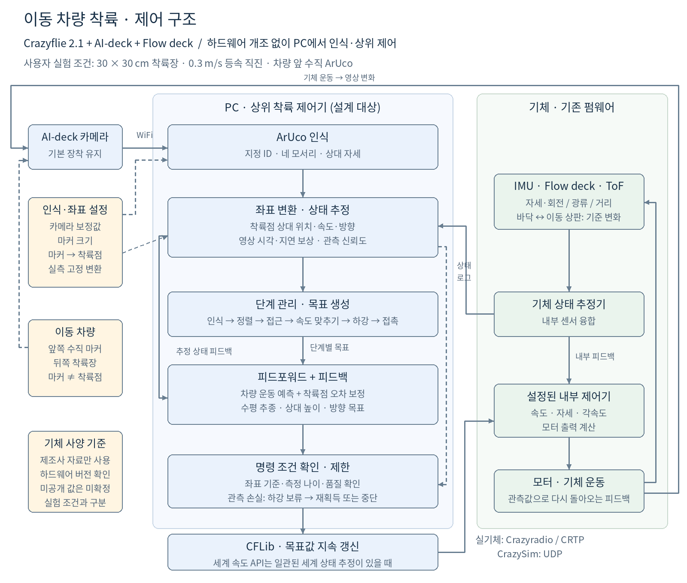
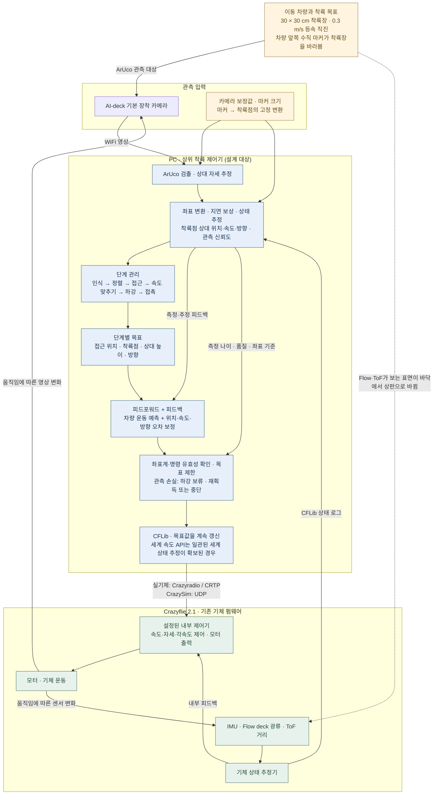
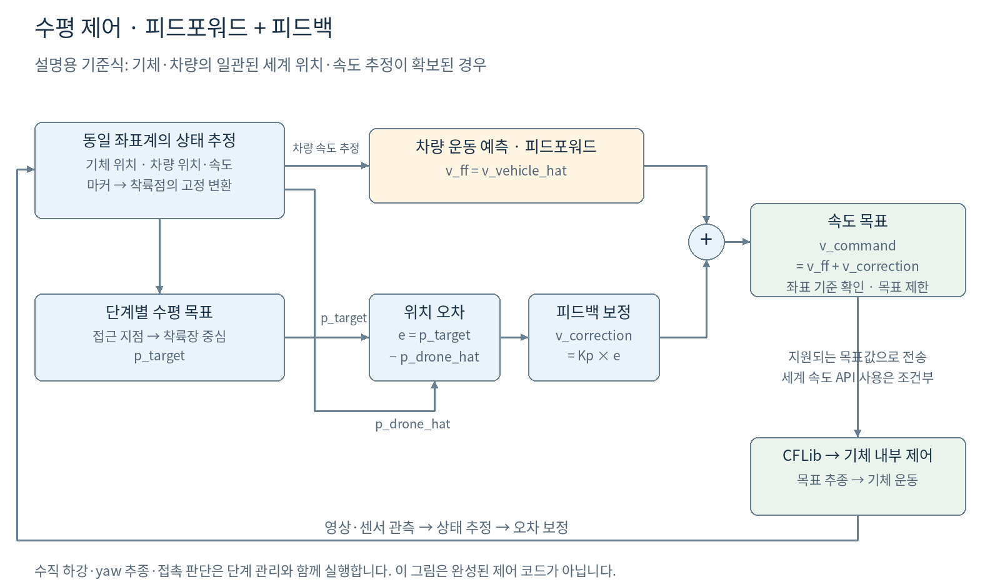
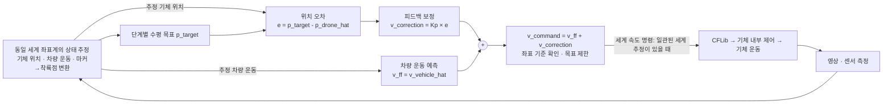
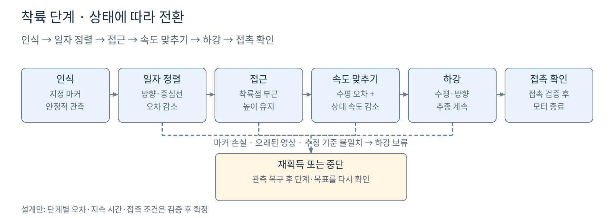
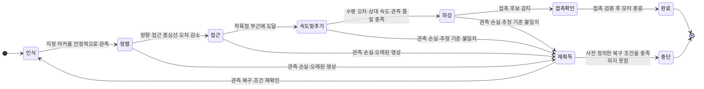

# 이동 차량 착륙 제어 다이어그램

2026-10-09 단계 판단과 하위 제어 분리에 맞춘 [계층 구조 설명과 레퍼런스](mission3/hierarchical-control-20261009.md), [편집 가능한 계층 선도](diagrams/mission3-hierarchical-control.mmd)를 추가했다. 이 구조 변경은 기존 동작 보존 회귀를 통과했으며 물리 실행기의 마지막 접촉 지원 연결 로직은 그 설명에서 별도로 표시한다.

2026-10-09 현재 미션3의 [간단 블록선도와 설명](mission3/simple-control-diagram.md), [간단 SVG](diagrams/mission3-simple-control.svg), [현재 상세 선도](diagrams/mission3-rpyt-control.svg)가 추가됐다. 아래는 이전 설계 조건과 비교를 보존한 기록이다.

작성일: 2026-09-30. 설계안이며, 영상 착륙 제어의 구현·실비행 검증을 의미하지 않습니다.

## 확정 조건

Crazyflie 2.1에 AI-deck와 Flow deck를 사용할 예정입니다. 하드웨어 개조 없이 제조사 장착 방법을 따르며 소프트웨어 변경은 허용되는 것으로 이해합니다. 실기체·Crazyradio는 아직 없습니다. 영상 인식과 상위 착륙 제어 계산은 PC에서 실행하고, 자세 안정화와 모터 제어는 기체의 기존 펌웨어가 담당합니다.

차량은 0.3 m/s로 등속 직진하며 착륙장은 30 × 30 cm입니다. 차량 앞쪽에 깃발처럼 세운 ArUco 마커는 뒤쪽 착륙장을 향합니다. 마커 중심과 착륙장 중심은 서로 다른 점입니다. 관측 시험용 임시값은 마커 한 변 10 cm, 착륙점보다 앞 40 cm·위 15 cm입니다. 실제 차량 치수로 확정한 것은 아닙니다.

모든 기체 사양은 제조사 자료로 확인합니다. 제조사 사양과 사용자 실험 조건을 구분하며, 미공개 값에 제3자 모델 수치를 넣지 않습니다. 상세 근거는 [제조사 사양 기록](manufacturer-specs.md)에 정리합니다.

## 전체 제어 구조

편집 원본: [control-overview.mmd](diagrams/control-overview.mmd).





영상은 AI-deck의 WiFi 경로로 PC에 들어갑니다. PC는 마커 검출 결과와 기체 상태 로그를 시간·좌표 기준에 맞춰 결합하고, 현재 비행 단계에 필요한 목표값을 계산합니다. 비행 목표값은 실기체에서는 Crazyradio/CRTP, CrazySim에서는 UDP를 통해 CFLib로 전송합니다. 영상 전송과 비행 명령 전송은 서로 다른 경로입니다.

내부 루프는 IMU·광류·거리 센서로 상태를 추정하고 전송된 목표를 따라 모터 출력을 조정합니다. 기체 운동이 다시 영상과 센서 측정에 반영되어 피드백 루프를 닫습니다. 그림은 설정된 제어기·목표 종류에 따른 기능 구분이며, 특정 펌웨어 내부 루프 주기를 확정하지 않습니다.

## 제어기가 계산하는 것

**우리가 만드는 것은 상위 착륙 제어기이며 그 출력이 기체 명령입니다.** 이 제어기는 관측과 오차를 피드백으로 받아 매 시점 속도·하강·yaw 목표를 계산합니다. 비행 단계 관리자도 별도로 필요합니다. 기체 펌웨어의 기존 속도·자세·각속도 안정화 루프를 활용하므로 모터 제어기부터 모두 새로 만드는 범위는 아닙니다. 이동 표면에서 내부 추정의 기준을 맞추는 소프트웨어 처리는 추가 설계 대상입니다.

편집 원본: [control-law.mmd](diagrams/control-law.mmd).





피드포워드는 차량의 움직임을 예측해 따라가는 성분이고, 피드백은 착륙점과의 오차를 줄이는 성분입니다. 같은 세계 좌표계에서 일관된 위치·속도 추정이 확보되었을 때의 설명용 수평 기준식은 다음과 같습니다.

```text
e_xy = p_target_xy - p_drone_xy
v_command_xy = v_vehicle_estimated_xy + Kp × e_xy
```

`p_target`은 마커의 중심이 아니라 현재 단계가 선택한 접근 지점 또는 착륙점입니다. 마커 자세와 마커→착륙점 변환으로 이를 구합니다. 처음에는 차량 뒤쪽 접근 지점, 최종적으로는 착륙장 중심을 목표로 삼습니다. 하강 중에도 수평 위치·상대 속도·방향을 계속 보정합니다. 상대 속도 감쇠, 목표 제한, 필터·지연 보상과 수직 제어는 추가 설계 대상입니다. 이 기준식만으로 완성된 제어기는 아닙니다.

실험의 0.3 m/s는 차량에 주는 설정값입니다. 최종 영상 제어기의 차량 운동 추정과 동일한 것으로 취급하지 않습니다. 시뮬레이터의 참값을 사용하는 독립 테스트는 따로 표시합니다. 또한 속도 피드포워드는 차량 선회가 없고 같은 방향·같은 좌표 기준이 확인된 경우에만 그 방향으로 적용합니다.

세계 속도 목표 API는 **일관된 세계 상태 추정이 확보된 경우**의 후보입니다. Flow deck가 움직이는 차량 상판을 보면 광류가 그 표면에 대한 상대 움직임을 나타냅니다. 기존 추정기가 이를 정지 바닥으로 해석하는 상황에서 차량 속도를 단순히 더하면 올바른 세계 속도 제어가 되지 않습니다. 좌표 변환만으로 이 문제가 해결되지 않으므로 표면 전환 시의 추정 모델·센서 사용 정책과 지원되는 명령 인터페이스를 함께 검증해야 합니다. [인터페이스 검토](control-interface.md)를 참고합니다.

## 단계 전환

편집 원본: [landing-states.mmd](diagrams/landing-states.mmd).





사용자 순서인 인식 → 일자 정렬 → 접근 → 착륙을 유지하되, 착륙 전에 **차량과 상대 속도를 맞추는 단계**를 넣습니다. 위치가 맞아도 상대 속도가 크면 30 cm 상판을 지나칠 수 있기 때문입니다.

단계 전환의 오차 기준과 지속 시간은 아직 정하지 않았습니다. 하강은 수평 정렬, 상대 속도, 관측 품질이 함께 충족된 뒤 시작합니다. 실제 기본 카메라로 마지막 하강까지 마커를 계속 볼 수 있는지는 제조사 사양과 실제 보정값을 바탕으로 확인해야 합니다. 마커가 사라진 것을 접촉으로 판정하지 않습니다. 기본 설계는 관측 손실 시 하강을 보류하고 재획득 또는 중단하며, 관측 없이 예측만으로 마지막 하강을 수행하는 방식은 별도 검증 후 추가할 수 있습니다.

## 강화학습과 비교할 경계

영상 인식·상태 추정·단계 관리·명령 제한·기체 내부 제어는 공통으로 두고, 외부 제어 블록을 비교합니다.

| 구분 | 피드포워드 + 피드백 | 강화학습 정책 |
| --- | --- | --- |
| 입력 | 같은 상대 상태·관측 품질·단계별 목표 | 같은 입력, 필요 시 같은 관측 이력 |
| 계산 | 차량 운동 예측과 명시한 오차 보정 | 학습한 관측→행동 정책 |
| 출력 | 공통으로 정의한 목표값 또는 보정량 | 동일한 단위·좌표계의 목표값 또는 보정량 |
| 이후 경로 | 공통 명령 제한·CFLib·기체 내부 제어 | 동일한 경로 |

이 비교 경계는 제안입니다. 실제 지원되는 제어 인터페이스가 확정된 뒤 행동 공간을 고정합니다. 강화학습 성능·성공률을 측정한 결과는 아직 없습니다.

## 현재 구현 범위와 다음 작업

2026-10-04 팀 공유 ROS 2 SIL에 정지 마커 상대 yaw 관측·상위 회전 명령·이륙/착륙 상태기계를 구현했다.
정상 방향 복귀와 영상 누락 복구 시험을 통과했다. 이 구현의 편집용 흐름도는
[yaw-static-control.mmd](diagrams/yaw-static-control.mmd), 세부 결과는 [yaw 첫 구현 기록](yaw-first-simulation.md)이다.
위의 이동 차량 착륙 구조 전체와 정지 yaw 시제를 구분한다. 아래 기존 직접 CFLib·기하 시험 기록도 유지한다.

그림은 PNG와 SVG로도 저장했습니다. Mermaid 원본은 각 그림의 블록·연결 구조를 편집하는 파일이고,
PNG/SVG의 배치·글꼴 원본은 `scripts/render_control_diagram.py`입니다. 그림을 다시 생성하려면 다음을 실행합니다.

```bash
./.venv/bin/python ./scripts/render_control_diagram.py
```

현재 기존 CrazySim의 기본 이륙·착륙 데모와 별도의 이동 차량·ArUco 관측 기하 시험을 구현·검증했습니다. 관측 시험은 광학 중심 경로를 직접 지정합니다. [결과와 실행](visibility-experiment.md)을 참고합니다. 현재 기본 업그레이드 모델과 다른 외부 모델을 제조사 기반 Crazyflie 2.1 모델로 간주하지 않습니다. 착륙 단계 관리자와 위 상위 제어기, 이동 차량의 기체 동역학·접촉은 아직 구현하지 않았습니다.

기존 직접 CFLib 예제의 Flow가 꺼진 경로는 시뮬레이터 외부 pose를 기체 추정기에 입력합니다.
현재 공유 SIL의 yaw 시험은 Flow를 켜서 이 pose 주입을 사용하지 않습니다.
다만 공유 MuJoCo의 광류 생성은 관측 표면의 이동 속도를 빼지 않습니다.
정지 마커 yaw 시험으로 실제 Flow deck의 바닥→이동 상판 전환을 검증했다고 주장하지 않습니다.
이 차이와 실제 API의 좌표·단위는 [인터페이스 검토](control-interface.md)에 기록했습니다.

다음 구현은 제조사 사양과 기본 장착의 관측 기하를 확인한 뒤, 차량·수직 마커 장면과 영상 인식 경로부터 만듭니다. 정지 표적 추종을 검증한 다음 등속 차량 추종·속도 맞추기·하강으로 진행합니다.

## 공식 참고 자료

- [Bitcraze AI-deck 제품 및 WiFi 기능](https://www.bitcraze.io/products/ai-deck/)
- [Bitcraze WiFi 영상 스트리머](https://www.bitcraze.io/documentation/repository/aideck-gap8-examples/master/examples/wifi-streamer/)
- [Bitcraze Flow deck v2의 광류·거리 센서](https://www.bitcraze.io/products/flow-deck-v2/)
- [Bitcraze commander와 setpoint 제어 경로](https://www.bitcraze.io/documentation/repository/crazyflie-firmware/master/functional-areas/sensor-to-control/commanders_setpoints/)
- [CFLib 공식 commander 구현](https://github.com/bitcraze/crazyflie-lib-python/blob/master/cflib/crazyflie/commander.py)
- [OpenCV ArUco 검출과 자세 추정](https://docs.opencv.org/4.x/d5/dae/tutorial_aruco_detection.html)
