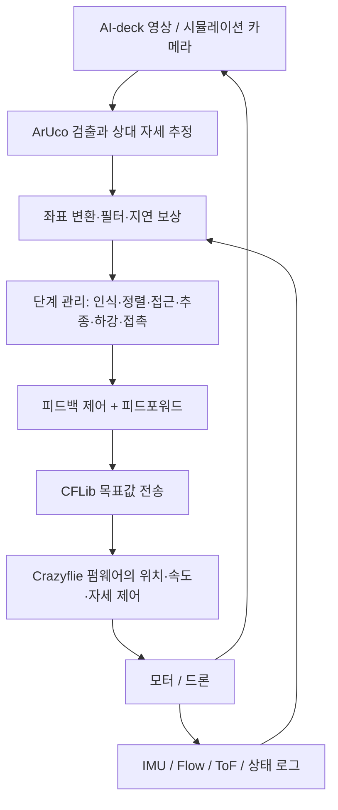

# 움직이는 차량의 ArUco 마커 기반 자율 착륙 설계

작성일: 2026-09-30 (Asia/Seoul).

이 문서는 설계안입니다. 기본 CrazySim 비행 데모 외에 차량·수직 마커·가상 카메라 경로와
ArUco 검출·자세 추정 기하 시험을 구현했습니다. [관측 시험 결과](visibility-experiment.md)를 참고합니다.
상위 착륙 제어기·기체 동역학의 이동 차량 착륙·접촉 판정은 아직 구현하지 않았습니다.

## 사용자 목표 및 임시 전제

- 실제 기체: Crazyflie 2.1 + AI-deck + Flow deck.
- 차량 앞쪽에 깃발처럼 세운 수직 ArUco 마커가 뒤쪽 착륙장을 바라보게 배치합니다. 마커 중심과 착륙점은 서로 다릅니다.
- 사용자 순서: 마커 인식 → 일자로 정렬 → 접근 → 착륙.
- 첫 제어기: 강화학습 대신 기존 피드백 제어에 이동 예측 피드포워드를 결합합니다.
- 영상 인식과 외부 착륙 제어 계산은 PC에서 실행합니다. 사용자 확정 사항입니다.
- 하드웨어 개조는 금지되어 있고, 장착은 제조사 방법을 따릅니다. 소프트웨어 변경은 허용되는 것으로 이해합니다. 카메라를 아래로 재장착하거나 모터·프로펠러를 바꾸는 설계는 사용하지 않습니다.
- 실기체·Crazyradio는 아직 없고 시뮬레이션 승인 후 지급 예정입니다. 지급될 데크 버전과 승인 기준은 아직 정해지지 않았습니다.
- 초기 실험 조건은 30 × 30 cm 착륙장, 0.3 m/s 등속 직진입니다. 사용자가 확정했습니다.
- “일자로 정렬”은 드론과 차량의 yaw 및 접근 중심선을 맞추는 것으로 임시 해석합니다. 사용자 확인이 필요합니다.
- 실제 카메라 장착 변환·캘리브레이션은 미확정입니다. 가상 실험은 DICT_4X4_50 ID 0·한 변 10 cm, 착륙점→마커 (앞 40 cm, 옆 0, 위 15 cm), 상판 높이 20 cm를 임시값으로 지정했습니다. 기체 사양과 구분합니다.
- 기체·데크·카메라·배터리·추진계의 모든 사양은 제조사 자료를 기준으로 합니다. 버전과 공식 출처를 기록하며 미확정 값에 제3자 모델 수치를 대입하지 않습니다. [제조사 사양 기록](manufacturer-specs.md)을 참고합니다.
- 소프트웨어 수정이 가능하다는 사용자의 현재 이해를 기준으로 추정기·관측 전환을 설계하고, 장비 지급 시 실제 규정과 대조합니다.

## 제어 구조

검토한 전체 제어도, 피드포워드·피드백 블록도 및 단계 전환은
[제어 다이어그램](control-diagram.md)에 정리했습니다.



영상 기반 착륙 계산과 기체의 빠른 자세 안정화를 분리합니다.
우리가 설계하는 PC 상위 제어기는 상대 상태에서 매 시점 목표 속도·하강·yaw를 계산합니다.
그 출력이 기체에 전송되는 제어 명령입니다. 단계 관리와 피드백 계산은 둘 다 구현 대상입니다.
첫 버전은 PC에서 영상·착륙 루프를 계산하고, STM32의 기존 펌웨어가 내부 제어를 담당합니다.
실제 영상은 AI-deck WiFi 스트리밍, 비행 명령은 Crazyradio/CFLib 구성을 우선 제안합니다.
CPX를 통한 WiFi 명령 전송도 가능하지만, 첫 구현에서는 영상과 제어 경로를 분리하면
각 경로의 지연·실패를 분석하기 편합니다. AI-deck 전체 탑재형 계산은 별도 이식 작업입니다.

## 인식과 상태 추정

ArUco ID와 네 모서리를 검출하고, 실측 마커 한 변 길이와 카메라 내부 파라미터·왜곡 계수를
사용해 `solvePnP`로 마커→카메라 변환을 구합니다.
카메라→기체 변환과 IMU 자세를 적용해 제어 좌표계의 상대 위치·yaw를 계산합니다.
마커의 방향이 차량 방향과 어떻게 대응되는지도 고정해야 합니다.
마커 위치와 실제 착륙점이 달라도 됩니다. 차량에 고정된 마커→착륙점 변환을
실측해 두면 마커로 착륙점의 상대 위치를 계산할 수 있습니다.

제어기로 넘길 값:

- 검출 ID, 유효 여부, 검출 모서리 및 재투영 오차.
- 좌표계가 명시된 상대 위치 `r`, 상대 속도 `r_dot`, 상대 yaw.
- 차량 상판에 대한 상대 높이 `h_pad`, 영상 시각·수신 시각·측정 나이.
- 드론의 자세·속도 추정 및 해당 속도의 기준 표면/신뢰도.

상대 속도는 영상 위치를 단순 차분하기보다 시간 정보가 포함된 필터로 추정합니다.
회전하는 기체 좌표계의 위치 차분을 세계 좌표 속도처럼 사용하면 안 됩니다.
PC 수신 시각은 카메라 촬영 시각과 다릅니다. 초기에는 수신 시각과 측정된 지연을 사용하고,
필요하면 영상 송신 쪽의 프레임 시각·시퀀스를 추가해 보상 정확도를 높입니다.

## 피드백과 피드포워드

같은 세계 좌표계에서 신뢰할 수 있는 드론·차량 속도를 확보한 경우,
수평 속도 목표의 첫 기준식은 다음과 같습니다.

`v_drone_cmd = v_car_hat + Kp * (p_car_hat + offset - p_drone_hat)`

- `v_car_hat`: 차량과 같은 속도로 움직이게 하는 피드포워드.
- `Kp * error`: 마커와의 위치 오차를 줄이는 피드백.
- `offset`: 접근 중에는 차량 뒤쪽 대기 지점, 최종 추종에서는 마커와 다른 착륙장 중심. 마커→착륙점의 고정 변환을 적용합니다.

정렬 오차와 상대 속도 오차가 작아진 뒤 상대 높이 목표를 낮춥니다.
하강 중에도 수평 추종과 yaw 정렬을 계속 수행합니다.
단순 피드포워드만으로는 관측 오차·바람·차량 움직임 변화가 남기므로 이 목표에는 피드백이 필요합니다.

차량의 세계 속도를 추정하기 어려우면 영상 기반 상대 위치·속도 제어가 첫 설계 대상입니다.
기존 펌웨어 속도 루프의 기준과 센서 추정 기준을 맞추거나,
상대 상태를 사용하는 외부 가속도/자세 제어 루프로 설계를 바꿔야 합니다.
후자는 고도·추력 루프까지 책임져야 하므로 단순히 API를 바꾸는 작업이 아닙니다.

## Flow deck과 카메라의 핵심 제약

Flow deck의 광류는 아래 보이는 표면에 대한 움직임입니다.
정지한 바닥에서 움직이는 차량 상판으로 시야가 넘어가면 기준 표면이 바뀝니다.
따라서 차량 위의 Flow 속도를 드론의 절대 세계 속도라고 간주해 차량 속도 피드포워드를
더하면 오히려 틀린 목표를 만들 수 있습니다. 차량 위를 보는 동안의 추정 모델·센서 사용 정책을
구분하고, 마커 기반 상대 상태와 일관되게 처리해야 합니다.

ToF 역시 바닥에서 상판으로 넘어갈 때 측정 거리가 바뀝니다.
세계 높이, 펌웨어가 추정한 높이, 상판까지의 센서 거리는 서로 구분합니다.
마커가 사라졌다는 이유만으로 착륙 또는 접촉 완료를 판정하지 않습니다.
마커·ToF·IMU와 제어 상태를 함께 사용해 마지막 하강/접촉 상태를 판정해야 합니다.

사용자가 기체 수정을 금지했으므로 실제 기본 카메라의 각도·시야를 먼저 측정합니다.
전방만 보는 카메라는 마커 바로 위에서 목표를 놓칠 수 있고,
큰 단일 마커는 가까워질수록 영상 밖으로 잘리거나 원근 변형 때문에 검출이 어려워집니다.
카메라 방향을 시뮬레이션에서 임의로 아래로 바꿔 이 문제를 없애면 실기체 검증과 맞지 않습니다.

사용자는 차량 앞쪽의 수직 마커 배치를 선택했습니다. 마커→착륙점 변환으로 목표를 계산합니다.
이 배치가 실제 기본 카메라 시야·해상도·근거리 영상 품질 안에서 유효한지는 별도로 확인합니다.

상판의 평평한 마커 하나와 기본 전방 카메라로 배치가 고정되어 있다면,
마지막 구간은 시각 관측 없이 추정으로 비행해야 할 수 있습니다. 시야가 끝나기 전에
상대 속도·방향을 맞추고, 마지막 유효 상대 상태를 예측하면서 짧은 하강을 수행하는
별도 terminal 상태를 설계합니다. 이 방법은 그 구간의 차량 가속도·선회, 예측 오차,
상판 크기와 하강 시간을 제한해야 하며 일반적인 이동 차량 착륙을 보장하지 않습니다.
ToF는 수직 거리를 보완하지만 사라진 마커의 수평 위치를 다시 측정해 주지는 않습니다.
강화학습도 관측되지 않는 차량의 임의 움직임을 알아낼 수는 없습니다.

따라서 첫 구현은 기체 기본 장착의 카메라로 마커가 언제 보이고 언제 사라지는지 확인하는
관측 가능성 실험입니다. 이 결과로 마커 배치 또는 terminal 예측의 허용 범위를 정합니다.

## 비행 단계

| 단계 | 역할 | 다음 단계 조건 |
| --- | --- | --- |
| 인식 | 지정 ID를 연속 관측하고 상대 자세를 초기화 | 검출 안정성·측정 품질 확보 |
| 정렬 | yaw와 차량 접근 중심선을 맞춤 | 방향/횡방향 오차가 일정 시간 작음 |
| 접근 | 대기 지점에서 착륙점 부근으로 이동, 높이 유지 | 착륙점에 대한 수평 오차가 작음 |
| 속도 맞추기 | 차량과의 상대 속도를 줄임 | 위치·상대 속도 오차가 모두 일정 시간 작음 |
| 하강 | 상판 상대 높이를 낮추면서 수평·yaw 추종 유지 | 접촉 판단 조건 충족 |
| 마지막 예측 하강 (필요 시) | 계획된 시야 이탈 뒤 짧은 시간 동안 상대 상태 예측, ToF로 높이 보완 | 사전에 검증한 예측 오차·시간·상판 경계 조건 안에서 접촉 |
| 접촉/완료 | 접촉 확인 후 추력 종료·disarm | 완료 로그 기록 |
| 재획득/중단 | 검출 품질 저하·오래된 영상·추정 기준 불일치 처리 | 유효 관측이 복구되면 적절한 단계로 복귀 |

단계는 “몇 초 후 이동”만으로 진행하지 않고 관측 상태와 오차로 전환합니다.
속도·가속도 제한, 단계 전환의 히스테리시스, 연속 유효 관측 조건을 적용합니다.
예상하지 않은 마커 손실이면 하강을 멈추고 현재 단계·고도·추정 신뢰도에 맞게 재획득 또는 중단합니다.
예상된 시야 이탈이라고 해도 마지막 예측 하강에 들어가는 조건을 먼저 만족해야 합니다.
차량이 움직이는 상황에서 단순 세계 좌표 정지/호버가 목표 위 유지와 같지는 않습니다.
이 정책은 실제 속도·상판 크기·시야 범위를 정한 뒤 구체화합니다.

## Crazyflie에 보내는 명령

안정된 세계 상태 추정이 있는 첫 시뮬레이션 버전은 다음 API를 후보로 사용합니다.

```python
# vx, vy, vz: 세계 좌표 속도 목표 [m/s]
# yaw_rate: yaw 각속도 목표 [deg/s]
cf.commander.send_velocity_world_setpoint(vx, vy, vz, yaw_rate)
```

초기 외부 제어 주기는 50Hz를 후보로 두고, 영상 주기와 지연을 실제로 측정해 조정합니다.
카메라 프레임 처리와 목표값 전송을 분리하여 영상이 늦어져도 전송 루프를 막지 않습니다.
저수준 목표는 지속적으로 갱신해야 하며, 영상이 없을 때도 정의한 재획득/중단 목표를 전송합니다.
착륙 동안 high-level commander와 low-level commander를 동시에 제어 권한으로 사용하지 않습니다.

`send_hover_setpoint(vx, vy, yaw_rate, z)`는 수평 속도를 기체 좌표계로 받지만,
설치된 펌웨어의 hover decoder는 `z`를 `setpoint.position.z`에 넣습니다.
이 인자를 마커까지의 카메라 거리 또는 원시 ToF 값과 동일하다고 가정하지 않습니다.

위 코드 한 줄은 API 설명이며 완성된 착륙 프로그램이 아닙니다.
arming, 상태 초기화, 좌표 변환, 목표 제한, 관측 실패 처리, 접촉 판단이 별도로 필요합니다.
시뮬레이션의 UDP 연결을 실제 기체의 radio URI로 바꾸는 것만으로 이 설계가 검증되는 것도 아닙니다.

## 현재 CrazySim 상태와 필요한 확장

기본 CrazySim 실행기는 펌웨어와 기본 비행 환경을 실행합니다.
MuJoCo 백엔드 소스에 카메라와 Flow deck 기능은 있지만 프로젝트 실행기는 아직 해당 옵션을 노출하지 않습니다.
별도 `preview_landing.sh`에 차량 운동, 상판·ArUco 패턴 및 영상 자세 추정 시험을 추가했습니다.
현재는 기체 동역학 없는 가상 광학 중심 경로이며 실제 장착 변환·폐루프 착륙은 추가해야 합니다.
카메라 장착 기하는 실제 기체의 기본 장착과 일치시킵니다. 현재 MuJoCo 모델의 FPV 시야각은
실제 AI-deck 카메라를 실측한 값이 아니므로 캘리브레이션에 맞춰야 합니다.
현재 프로젝트 기본 모델 `cf2x_T350`은 추력 업그레이드 모델입니다.
`cf2x_L250` 등 다른 외부 모델도 제조사 기반 Crazyflie 2.1 모델로 자동 인정하지 않습니다.
사용자 요구에 따라 표준 기체·데크·배터리 사양을 공식 자료와 대조해야 하며,
공개되지 않은 관성·추력 곡선 등은 미확정으로 남깁니다. 실측값이나 제3자 값을
보완 수단으로 사용하려면 제조사 사양에 관한 사용자 요구를 먼저 확인해야 합니다.

체크아웃한 MuJoCo의 `DroneAgent.compute_flow()`는 드론의 세계 속도를 기체 좌표로 바꿔 광류를 생성하며,
관측 표면의 속도를 빼지 않습니다. 따라서 움직이는 차량 위의 실제 광류를 검증하려면
광선이 만난 표면의 위치·선속도·회전속도를 반영하는 센서 모델로 보완해야 합니다.
기본 설정은 시뮬레이터의 외부 pose를 펌웨어에 보내므로 Flow-only 하드웨어보다 상태 추정이 이상적입니다.

시뮬레이터의 실제 위치·차량 속도는 평가와 초기 독립 제어 테스트에만 사용하고,
최종 영상 제어기가 그 값에 접근하지 못하도록 관측 입력을 분리합니다.

## 구현 순서

1. 기본 장착 카메라로 정지 상판 마커의 검출 거리·접근각·시야 이탈·근거리 검출 가능 범위를 확인하고 상대 위치·yaw를 화면에 표시.
2. 정지 상판 위 정렬·접근·호버. 아직 하강하지 않고 좌표계와 추종 오차 확인.
3. 정지 상판 착륙 및 마커 손실/접촉 처리. 필요하다면 먼저 짧은 마지막 예측 하강의 허용 범위를 검증.
4. 저속 등속 직진 차량 추종 및 상대 속도 맞추기, 피드포워드 유무 비교.
5. 이동 차량 착륙, 이후 가감속·선회·영상 지연·검출 누락을 추가.
6. Flow deck의 이동 표면 모델과 실제 센서·탑재 질량·관성·카메라 지연을 반영해 하드웨어 검증.

## 강화학습과 기존 제어 비교

| 항목 | 피드백 + 피드포워드 | 강화학습 |
| --- | --- | --- |
| 제어 규칙 | 상대 오차 및 운동 예측으로 명시 | 관측에서 행동으로 가는 정책을 학습 |
| 준비 작업 | 센서 보정·상태 추정·이득 조정 | 센서/동역학 모델 + 보상·학습 환경·훈련 |
| 실패 분석 | 오차·추정·이득·제한 조건을 따라 분석 | 정책 행동과 훈련 분포도 함께 분석 |
| 환경 변화 | 추정기·모델·설계 범위 안에서 대응 | 훈련/검증 분포 밖 성능은 별도 확인 필요 |
| 첫 구현 | 작동하는 기준 제어기를 만들기 유리 | 기준 제어기와 비교할 환경이 먼저 필요 |

두 방법 모두 “모든 상황” 대응을 보장하지 않습니다.
처음은 기존 제어기를 만들고, 필요하면 그 제어기에 잔차 행동을 더하는 강화학습을 비교 대상으로 삼습니다.
비교 시 동일한 관측 입력, 명령 인터페이스, 속도·가속도 제한, 차량 운동·영상 지연·검출 누락 조건을 사용합니다.
성공률, 접촉 위치 오차, 접촉 시 상대 속도, 완료 시간, 마커 손실 대응을 평가합니다.

## 참고 자료

- [AI-deck 제품 및 기능](https://www.bitcraze.io/products/ai-deck/)
- [AI-deck WiFi 영상 스트리머](https://www.bitcraze.io/documentation/repository/aideck-gap8-examples/master/examples/wifi-streamer/)
- [Flow deck의 광류와 거리 측정](https://www.bitcraze.io/products/flow-deck-v2/)
- [OpenCV ArUco 검출 및 자세 추정](https://docs.opencv.org/4.x/d5/dae/tutorial_aruco_detection.html)
- [Crazyflie commander와 제어 권한](https://www.bitcraze.io/documentation/repository/crazyflie-firmware/master/functional-areas/sensor-to-control/commanders_setpoints/)
- [설치된 CFLib commander 구현](../src/crazyflie-lib-python/cflib/crazyflie/commander.py)
- [설치된 CrazySim MuJoCo 구현](../src/CrazySim/crazyflie-firmware/tools/crazyflie-simulation/simulator_files/mujoco/crazysim.py)
- [이동 차량 착륙을 위한 visual servoing 연구](https://arxiv.org/abs/2104.01272)
- [Crazyflie 2.1에서 강화학습을 이용한 경사면 착륙 연구](https://arxiv.org/abs/2103.09043)
