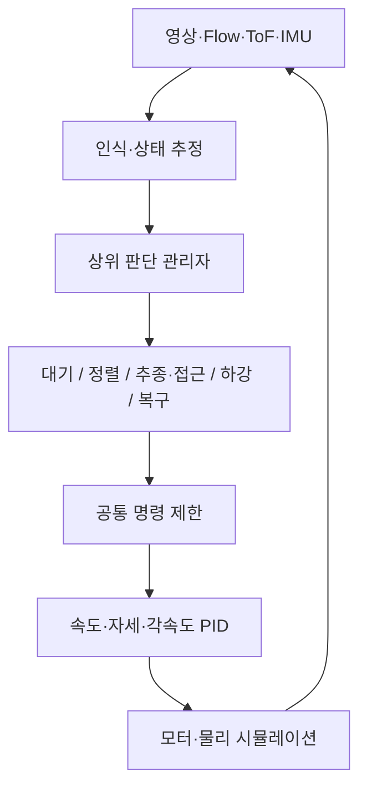

# 미션3 상위 판단과 하위 단계 제어

2026-10-09 사용자 요청으로 실제 단계 제어 코드를 분리했다. 상위 관리자는 관측 유효성과 전역 안전 조건을 검사하고 실행할 하위 제어기를 선택한다. 하위 제어기는 해당 단계의 명령과 완료 조건을 계산하며, 상위 관리자의 `enter`, `held`, `output`으로 전환·확인·출력을 요청한다. 설정, 제어 수식, 단계 전환 시각, 확인 시간, 명령 포화와 기존 PID를 보존하는 구조 변경이다.

## 구조와 책임



상위의 ‘제어’는 실행할 행동을 판단하는 역할이다. 하위 단계 제어는 속도와 yaw rate를 계산하며, 더 아래의 PID는 추정 상태가 명령을 따르도록 기체를 안정화한다. 단계가 바뀌어도 PID는 계속 실행된다. 차량 추정 속도 피드포워드와 상대 위치·속도 피드백은 함께 유지한다.

```text
scripts/mission3/
├── supervisor.py            MissionSupervisor: 전역 검사·단계 선택·공유 이력
├── acquisition_control.py   대기·영상 방위에 의한 발견 이후 제어
├── alignment_control.py     관측 안정화·차량 뒤 일직선 정렬
├── approach_control.py      높이 준비·추종·접근·상대속도 동기화
├── landing_control.py       마지막 영상 예측·Flow 확인·하강
├── recovery_control.py      실패 시 제한된 후퇴·상승·말기 안전 조건
├── command_limiter.py       한 비행이 공유하는 속도·가속도·yaw 제한
├── command.py               모든 단계의 공통 Command 형식
├── guidance.py              추정 입력과 공유 FF+feedback 수식
├── controller.py            기존 Mission3/Command import의 호환 진입점
├── vision.py                마커 검출·포즈와 차량 운동 추정
├── physical_estimator.py    자체 기체 센서 상태 추정
├── position_bridge.py       PC 속도 명령 → RPYT PID
└── flight_controller.py     공식 소스의 기체 PID·모터 분배
```

`run_mission3_physical.py`는 센서 전달, 실행 주기, 영상 지연, 물리 적분, 기록을 연결한다. 호버 준비는 `handoff.py`, 접촉 후보 관측은 `touchdown.py`, 실패 후 실제 명령 전달은 `abort_delivery.py`를 사용한다. 근접 기하 완료 이후의 지원 시험·모터 종료·3초 유지 연결 로직은 여전히 이 물리 실행기에 있다. 따라서 이번 변경을 모든 실행기 로직까지 완전히 분리한 것으로 표현하지 않는다. `mission3_automation.py`는 독립 시험 프로세스와 GUI를 관리하며 비행 판단에 직접 명령을 추가하지 않는다.

## 실행 인터페이스

기존 실행기는 계속 `from mission3.controller import Mission3, Command`와 `mission.update(now, own, vehicle)`를 사용한다. `Mission3`는 실제 `MissionSupervisor`의 호환 이름이다. 새 하위 제어기가 기존 호출 경로에서 실행되므로 GUI로 실행하는 다음 시험에도 구조가 적용된다.

```python
# 상위 관리자의 metric 단계 선택 부분
if self.phase in ("ACQUIRE", "LINEUP"):
    return self.alignment.update(self, frame)
if self.phase in ("LOWER_ALIGN", "APPROACH", "TRACK"):
    return self.approach.update(self, frame)
if self.phase in ("DESCEND", "BLIND_APPROACH", "BLIND_DESCEND"):
    return self.landing.update(self, frame)
```

`frame`은 센서·영상 추정과 정적 치수에서 유도한 입력이다. 차량 실제 위치나 설정 속도를 전달하지 않는다. 상태는 한 관리자가 소유하고, 단계 제어기는 현재 관리자의 맥락을 사용한다. 이는 독립 프로세스나 하위 AI 에이전트를 만드는 작업이 아니다.

전환 순간의 계산 순서를 보존한다. 예를 들어 TRACK에서 BLIND_APPROACH로 바뀌는 step은 이미 계산한 수평 명령을 유지하면서 착륙 단계의 조건을 확인한다. 이때 `ApproachControl`이 `LandingControl.finish`를 호출하지만 최종 명령은 하나만 반환한다. 별도 하위 제어기가 같은 step에 두 명령을 보내지 않는다.

## 보존한 동작

- 전역 시간·경계·불확실성 검사와 영상 유실/예측 만료가 정상 단계보다 먼저 적용된다.
- 최종 명령은 공통 `CommandLimiter`를 통한다. `last_v`와 `last_yaw_rate`는 같은 제한기의 상태이며 단계 전환 시 초기화하지 않는다. 기존 안전 중단의 urgent 정책도 유지한다.
- 현 직선 시험은 발견 전 고정 자리·시선 대기, 회전 탐색 없음이다. 과거 탐색 정책은 역사적인 실험 재현을 위해 별도 분기에 남아 있다.
- 기체 센서 추정기·공식 PID·모터 상태는 그대로 유지한다. 현재 PC 명령 계산 50Hz, PC 속도 PID/RPYT 전달 100Hz와 기존 기체 PID 호출 주기를 바꾸지 않았다.
- `GEOMETRY_READY`는 접촉 성공이 아니다. 실제 접촉·PWM 0·움직이는 패드에서 3초 유지와 후평가 조건이 필요하다.
- 경기장30×5m, 차량 최고.3m/s와 호버 준비 후 출발, native mono320, 기존 패드·마커·덱·포화 설정을 유지한다. 제조사 일치의 미확정 사양과 조건부 동역학 한계도 그대로다.

## 구조의 레퍼런스

| 자료 | 이 작업에서 참고한 부분 | 적용 범위 |
|---|---|---|
| [SMACC2: Hierarchical States](https://smacc2.robosoft.ai/tutorials/tutorial-9-hierarchical-states/) | 상위 운영 상태와 하위 상태 그룹, 상위 맥락 공유 | 계층형 상태머신의 실제 ROS2 예제. 이 프로젝트는 Python 모듈로 구현했다. SMACC2 라이브러리나 그 이벤트·이력 복원 기능을 채택했다는 뜻은 아니다. |
| [Bitcraze: Commander Framework](https://www.bitcraze.io/2020/05/the-commander-framework/) | 행동/명령 생성과 기체 setpoint 처리의 분리 | 상위 관리자 설계와 명령 경계의 제조사 참고. 우리 MissionSupervisor는 펌웨어 HighLevelCommander와 다른 프로젝트 코드다. |
| [Bitcraze: Controllers 공식 소스 문서](https://github.com/bitcraze/crazyflie-firmware/blob/master/docs/functional-areas/sensor-to-control/controllers.md) | 위치·속도·자세·각속도의 연쇄 PID와 입력 모드 | 기체 제어 계층. 이 문서가 우리 접촉 모델·조립 사양·착륙 성능을 검증해 주지는 않는다. 현재 실험은 기존에 고정한 공식 소스/runtime을 사용한다. |
| [Iovino 외, A Survey of Behavior Trees in Robotics and AI, 2020](https://arxiv.org/abs/2005.05842) | 행동을 계층 트리로 구성하고 재사용하는 대안 | 이후 미션 분기가 늘어날 때 비교할 구조. 이번 순서가 명확한 미션은 상태머신 스타일을 유지했다. |
| [Iovino 외, Comparison between Behavior Trees and Finite State Machines, 2024](https://arxiv.org/abs/2405.16137) | 두 구조의 반응성·모듈성·가독성·유지보수 비교 | 이동 조작 로봇에서의 비교이므로 드론 착륙 성능 우위를 직접 주장하지 않는다. |

현재 구현은 상위 관리자 아래에 단계별 제어를 묶은 계층형 FSM 스타일이다. 각 단계 완료 조건을 하위 모듈과 상위 관리자가 협력해 처리한다. Statecharts 전체 의미론이나 이벤트 큐를 새로 구현한 것은 아니다. 기존 선형 미션과 실패 복구를 옮길 때는 이 구조가 적절하다는 프로젝트 판단이다.

## 검증 기록

수정 전 소스 66파일을 `artifacts/mission3/hierarchical-refactor-20261009/before/`와 사전 계획에 보존했다. 수정 후 소스는 같은 디렉터리의 `after/`와 별도 manifest로 기록했다. 과거 16회 원로그·설정·영상은 덮어쓰지 않았다.

- 기존 미션3 회귀235개와 실행 프로그램 회귀5개 통과.
- 원16조건의 저장된 센서·영상 추정 입력에서 변경 전후28,480개 명령과 전환 이벤트 정확 일치. 원기록과 비교 가능한 명령도 확인했다. 기하 완료 후의 물리 지원 adapter는 이 재생 비교 범위에 포함하지 않는다.
- 대표 성공1.25m와 실패1.15m의 같은 seed/config 물리 회귀2회 완료. 각9개 원JSONL·controller 설정·고정 실험 설정·FFV1 영상이 변경 전과 바이트 단위로 정확 일치했고 결과 요약은 벽시계 실행 시간만 제외하면 같다. 소스76파일이 회귀 동안 고정됐고 변경 전66파일 snapshot도 그대로다. 상세 SHA는 `physical-comparison.json`에 기록했다.
- 1.25m는 원래와 같은53.18s 종료/PWM 종료50.14s, 조건부 접촉 후 유지. 1.15m는 원래와 같은55.561s 종료/`inertial_texture_bridge_prediction_expired` 실패이며 모터 종료 없음. 실패를 성공으로 바꾸지 않았다.
- 두 회귀 모두 정상 명령 포화 감사 통과, native 카메라703+760=1,463프레임의 입력 SHA 재생 검증 통과. 렌더 호출 수와 실제 전달·기록된 프레임 수를 구별했다. 실제 속력 상한 검증과 제조사 카메라 보정 검증을 의미하지 않는다.

재생 비교 실행 방법:

```bash
cd .
PYTHONNOUSERSITE=1 OPENBLAS_NUM_THREADS=1 OMP_NUM_THREADS=1 PYTHONPATH=scripts \
src/crazyflie-ros2-sil/.venv/bin/python scripts/verify_mission3_hierarchy.py \
  --before artifacts/mission3/hierarchical-refactor-20261009/before \
  --batch artifacts/mission3/automation/20261009-193646-264501 \
  --output artifacts/mission3/hierarchical-refactor-20261009/replay-rerun.json
```

이 검증은 구조 변경의 동작 보존 검사이며 독립 검토 서명·새 성능 표본·제조사 일치 검증·실기 비행으로 세지 않는다. 재생·물리 회귀를 과거16회 분모에 더하지 않는다.
