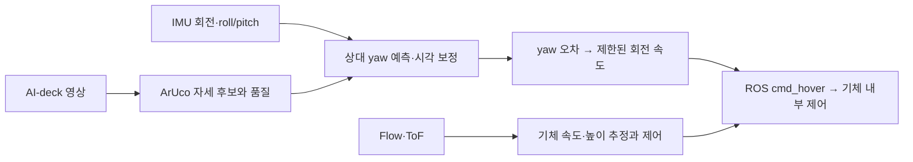

# AI-deck·Flow deck·기체 IMU를 이용한 yaw 보정 제안

작성일: 2026-10-04 (Asia/Seoul). 방식 설계 문서다. 같은 날 정지 마커 SIL 첫 버전을 구현했으며
구현·비행 검증 범위는 [첫 시뮬레이션 기록](yaw-first-simulation.md)에 구분해 기록한다.
같은 날 하위 에이전트 검토 결과를 반영했다. 근거와 우선순위는
[통합 검토](reviews/yaw-design-review.md)에 기록한다.

## 목표와 조건

사용자는 AI-deck·Flow deck·Crazyflie만을 센서로 사용하며, 처음에 전방 ArUco 마커를 향하게 놓고 이륙한다.
이전 합의대로 영상 처리와 상위 계산은 PC에서 수행하는 구성을 제안한다.
외부 카메라, Lighthouse, LPS, 추가 센서나 카메라 장착 변경을 요구하지 않는다.
현재 개발 baseline은 팀 ROS 2 SIL이며 제조사 실기체 사양 검증과 구분한다.

우선 목표는 **마커/차량과 원하는 상대 기수 방향을 유지하는 상위 yaw 제어**다.
이를 위한 PC의 상대 yaw 추정치를 보정한다. 이 작업만으로 기체 firmware 내부의
`stateEstimate.yaw`까지 시각 기준으로 보정되는 것은 아니다.
내부 추정기 보정이 필요한 경우에는 검증 후 별도 측정 융합 작업을 한다.

## 권장 구성

**ArUco 상대 자세 + IMU 회전 예측 + 품질에 따른 시각 보정 → 제한된 yaw_rate 명령**을 제안한다.
Flow와 ToF는 첫 정지 표적 시험의 수평 속도·높이 안정화를 맡긴다.

Bitcraze [센서·제어 설명](https://www.bitcraze.io/documentation/repository/crazyflie-firmware/master/functional-areas/sensor-to-control/)과
[Flow deck 데이터시트](https://www.bitcraze.io/documentation/hardware/flow_deck_2/flow_deck_2-datasheet.pdf)에 따르면
기체에는 자이로가 있고 Flow deck은 광류와 아래 표면까지의 거리를 제공한다.
이 센서 구성으로부터, 본 설계에서는 Flow를 절대 방위각 관측으로 취급하지 않는다.
마커로부터 얻는 방향도 북쪽 기준 절대 방위가 아니라 **마커 좌표계에 대한 상대 방향**이다.

| 방식 | 장점 | 제약 / 채택 |
| --- | --- | --- |
| 시작 yaw=0 + IMU만 유지 | 구현이 단순하고 영상 누락 중 예측 가능 | 초기 정렬은 드리프트를 지속적으로 관측하지 못함. 단독 기준으로 채택하지 않음 |
| 영상에서 마커 중심을 가운데로 돌림 | 자세 추정 없이 시야 확보·거친 정렬 가능 | 옆으로 이동한 것과 기수가 돌아간 것을 혼동할 수 있음. 차량 방향 정렬 판정에는 불충분 |
| 마커 상대 자세 + IMU 예측·보정 | 차량 방향에 대한 상대 yaw를 직접 다루고 시간 연속성 사용 가능 | 카메라 보정·평면 자세 후보 판별 필요. 주 방식으로 제안 |

## 시작 절차

1. 마커를 카메라 시야에 두고, 기수를 마커/차량의 정해진 방향에 대략 맞춘다.
2. 정지 상태에서 IMU 안정화와 마커 ID·영상 품질을 확인한다.
3. 여러 유효 관측으로 초기 상대 방향을 확인하고, 실험의 yaw 기준을 정의한다.
4. 이륙 후 짧은 호버 구간에서 기준과 관측을 다시 확인한다.
5. 정지 마커 yaw 보정만 실행한 다음 이동 차량 조건으로 확장한다.

초기 기수 방향을 yaw=0으로 정의하는 것은 좌표계의 기준 선택이다.
마커를 향하게 놓았다는 사실만으로 초기 정렬 오차가 정확히 0이거나
비행 중 yaw 드리프트가 없어지는 것은 아니다.
마커의 중심을 보는 방향과 마커 평면/차량 축에 맞춘 방향도 구분한다.

## 관측과 필터

- ArUco 네 모서리로 `solvePnPGeneric(..., SOLVEPNP_IPPE_SQUARE)`의 두 자세 후보를 유지한다.
  [OpenCV 공식 문서](https://docs.opencv.org/4.13.0/d5/d1f/calib3d_solvePnP.html)는
  카메라 내부 파라미터·왜곡 계수와 물체 좌표에서 카메라 좌표로의 변환, 복수 해를 설명한다.
- 마커 축/법선, 마커→차량 회전, 카메라→기체 회전을 일관되게 변환하여 상대 yaw를 구한다.
  `rvec`의 특정 성분이나 영상의 사각형 기울기를 기체 yaw로 바로 사용하지 않는다.
- 후보 선택에는 양의 깊이, 재투영 오차, 모서리 품질, IMU 예측과 이전 관측의 일관성을 사용한다.
  후보가 구분되지 않으면 관측을 보류하고 불확실성을 늘린다.
  후보별 상대 yaw를 비교하며 전체 자세 차이를 yaw 차이로 간주하지 않는다.
  초기 오선택을 시간 prior가 유지할 수 있으므로, 시간 일관성만으로 올바른 후보를 보장하지 않는다.
- 처음부터 정면에 보이는 평면 마커의 자세는 흔들릴 수 있다. 기존 기하 시험에서
  낮은 재투영 오차와 큰 회전 오차가 함께 나타났다. 단순 평균이나 저역 필터만으로
  잘못된 자세 후보를 고칠 수 있다고 가정하지 않는다. 근거: `docs/next-steps.md`.
- 첫 필터는 IMU로 회전을 예측하고 신뢰 가능한 영상 관측으로 천천히 보정하는
  상보 방식으로 시작한다. 필요하면 상대 yaw와 자이로 bias를 추정하는 작은 Kalman filter로 확장한다.
  자이로 bias와 마커 자체의 회전은 구분해야 한다. 정지 마커 또는 현재의 차량 직진 조건을 명시한다.
  bias 학습은 알려진 정지·방향 고정 구간으로 제한한다. 차량 선회·마커 흔들림·관측 모호성 구간에서는
  bias를 동결한다. 마커 회전이 미지이면 gyro bias와의 분리를 보장하지 않는다.
- 자세 변환에는 roll/pitch를 반영한다. 자이로의 body z 각속도를 모든 자세에서 Euler yaw 변화율로 간주하지 않는다.
- 영상 촬영/수신 시각, IMU 시각과 지연을 기록한다. 지연된 영상을 현재 각도로 그대로 섞지 않는다.
  촬영 시각을 확보하지 못하면 수신 시각 기준 근사와 한계를 명시한다.

카메라 내부 파라미터·왜곡, 카메라→기체 회전, 마커→차량 방향은 필요 정보다.
공유 시뮬레이션 모델의 카메라 정의는 그 모델에서만 사용하고 제조사 실물 보정값으로 주장하지 않는다.
마커 한 변 길이는 기존 가상 10 cm를 첫 시험 설정으로 사용할 수 있으며 제조사 기체 사양과 무관하다.

## 명령과 검증 경계

첫 yaw 제어는 `e_yaw = wrap(목표 상대 yaw - 추정 상대 yaw)`로 오차를 구하고
작은 P 이득, 회전 속도 제한, 작은 오차의 deadband로 시작한다.
각도 wrap·좌표축·명령 부호를 정지 표적 시험에서 검증한 뒤 필요할 때 감쇠 항을 추가한다.
초기 정지 바닥 시험에서는 body 수평 속도를 0으로 두고 기존 높이 제어와 함께 회전 속도를 보낸다.
이 명령을 이동 차량 위의 절대 정지/높이 유지와 동일하게 취급하지 않는다.

현재 팀 ROS server에는 `/cf231/cmd_hover` 구독이 있다.
`Hover.yaw_rate`는 로컬 callback에서 `-degrees(msg.yaw_rate)`로 바뀌어 CFLib에 전달된다.
ROS 입력은 rad/s이며 CFLib 인자는 deg/s다. 고정 firmware의 protocol 7에서는
CFLib legacy 패킷 인코딩과 firmware hover decoder에도 부호 변환이 있어,
전체 소스 경로의 내부 `attitudeRate.yaw = -degrees(msg.yaw_rate)`가 된다.
protocol까지 포함해 변환 계약을 관리하며 다른 버전에 이 결과를 그대로 적용하지 않는다.
최종 회전 방향은 해당 버전에서 작은 양/음 명령의 실제 응답으로 확인한다.
근거: `src/crazyflie-ros2-sil/crazyswarm2_ws/src/crazyswarm2/crazyflie/scripts/crazyflie_server.py:1189`.
현재 기본 pose 수신은 10 Hz이고 카메라는 설치 검사에서 약 18 Hz였다.
IMU 기반 예측을 구현하려면 필요 회전 로그·단위·시각·주기를 별도 설정하고 검증해야 한다.
현재 Image stamp는 TCP 수신·decode 뒤의 ROS 발행 시각이며 촬영 시각이 아니다.
기본 pose는 gyro를 포함하지 않는다. 읽은 odom callback의 angular 값도 firmware deg/s를
그대로 사용하므로 rad/s로 가정해 예측하지 않는다. 별도 gyro 로그·단위 변환·시계 매핑을 설계한다.

PID의 yaw rate 모드는 목표 각도를 적분해 움직인다. rate=0은 그 목표 유지이며
즉시 회전 정지나 내부 yaw 추정 보정을 보장하지 않는다.
`cmd_hover`는 yaw만 덧붙이는 명령이 아니라 수평·높이를 포함한 전체 setpoint이며,
수락되면 high-level planner를 중단한다. 이륙 완료 확인 후 단일 발행자로 전체 제어권을 인계한다.
복구 때는 새 계획과 우선순위 반환 순서를 명시한다. notify만으로 이전 계획이 복귀한다고 가정하지 않는다.

영상이 잠깐 누락되면 마지막 유효 관측과 IMU로 예측하되,
누락이 길거나 자세 후보가 계속 모호하면 시각 보정을 중지하고 첫 정지 표적 시험을 종료/복구한다.
오래된 각도에 큰 회전 명령을 유지하지 않는다.
영상 age·IMU age·명령 발행 age를 각각 관리한다. 시각 보정을 중단하는 것과
명령 스트림을 끊는 것을 구분하고, 정지 시험의 호버/착륙 복구 목표를 계속 관리한다.
firmware watchdog을 정상적인 시험 종료/착륙 절차로 사용하지 않는다.

첫 시험은 정지 마커·호버에서 진행한다. 결과에는 상대 yaw 오차, 회복 시간,
명령 포화, 자세 후보 전환, 검출 누락/지연과 추정 불확실성을 기록한다.
시뮬레이터 yaw 참값은 평가 로그에만 사용하고 관측기/제어기 입력으로 넣지 않는다.
그다음 차량 0.3 m/s 직진 조건에서 상대 방향 유지와 수평 이동을 분리하여 시험한다.
수치 이득과 통과 기준은 내부 실험 설정으로 정하며 제조사 성능 보증으로 제시하지 않는다.

firmware 내부 yaw 보정은 후속 작업이다. 상대 마커 자세를 그대로 world 자세로
`extpose` 주입하지 않는다. 마커의 world 방향·기체 변환, 측정 불확실성,
기존 추정기와의 상관관계를 정리한 뒤 yaw 측정 융합을 별도 설계한다.
