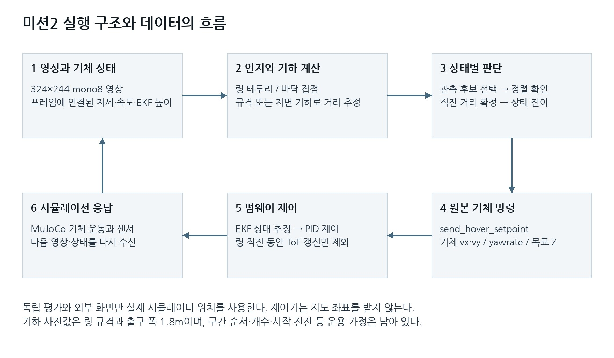
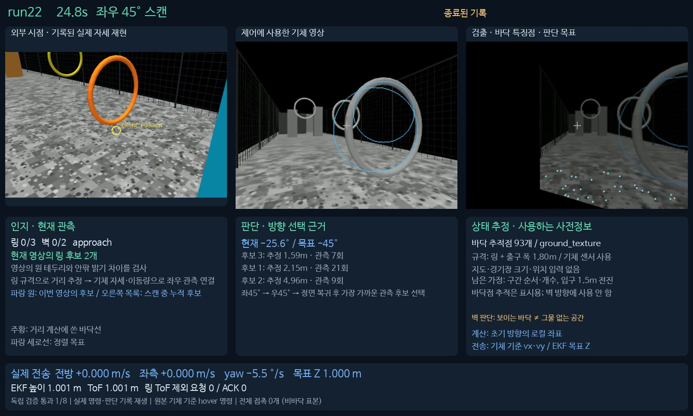
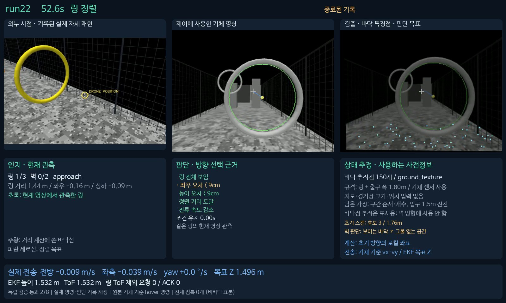
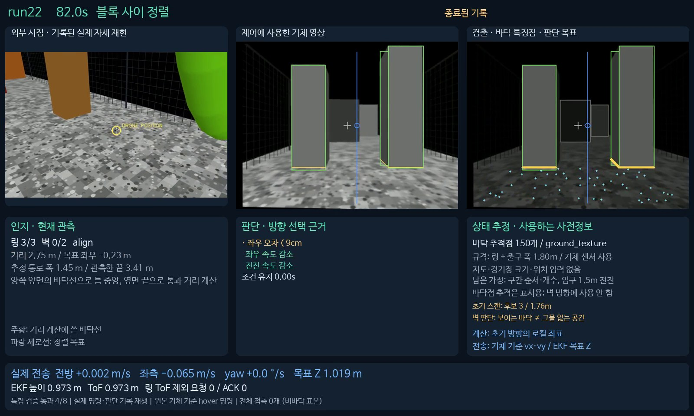
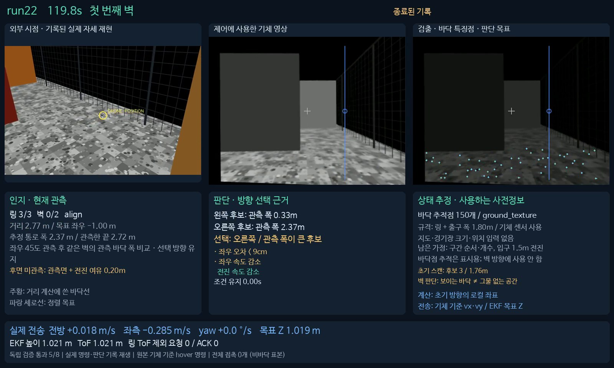
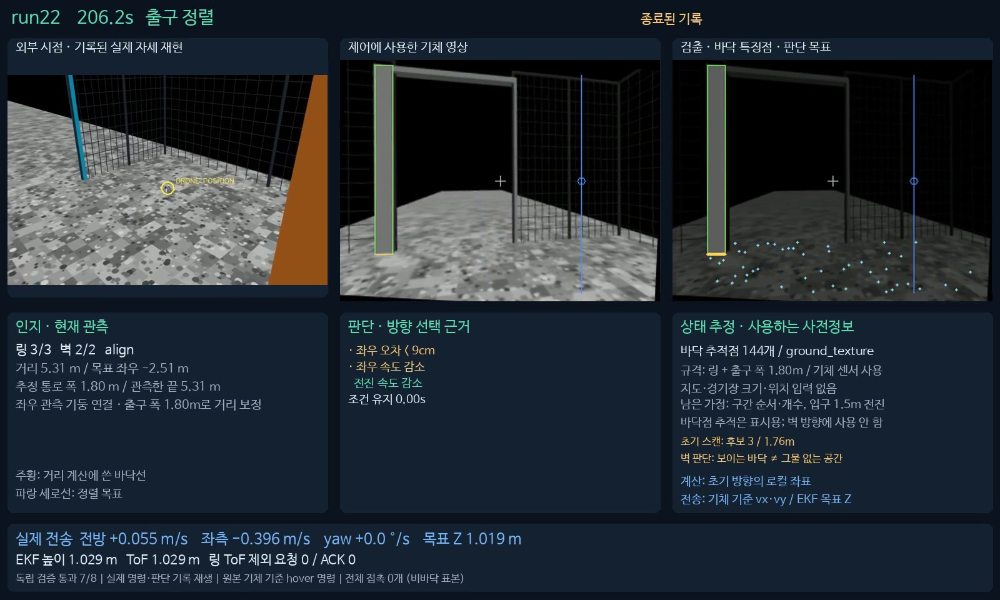
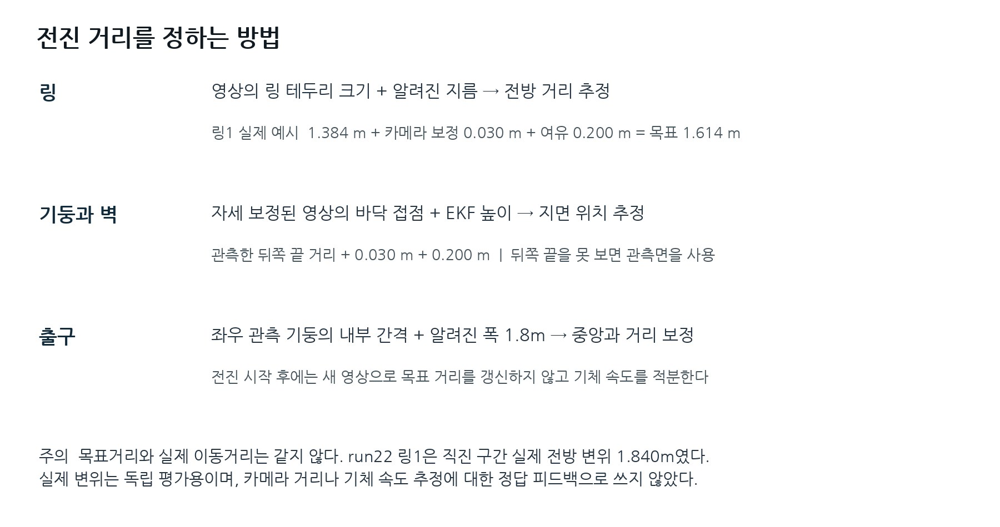
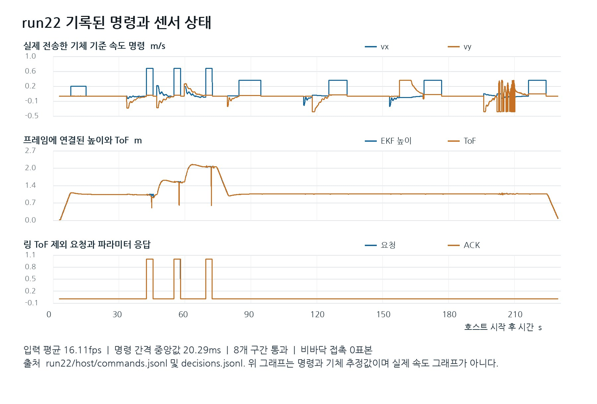

# 미션2 run22 — 설명용 기초 기술자료

작성 기준: 2026-10-27. 대상은 **run22에 동결한 삼각측량 미사용 정책**이다. 이 자료는 제작자가 수행 구조와 판단 근거를 이해한 뒤 직접 가공할 수 있도록 정리한 설명 자료다. 완성된 슬라이드나 발표 대본은 아니다. 세부 수식·상수·원본 JSON·명령 비교·재현 절차는 별도 파일 **Mission2_run22_기술원자료.md**에 있다.

**run22는 독립 재배치 맵에서 8개 구간을 순서대로 통과했고, 비바닥 접촉 표본 0, 호스트 DONE, 정상 종료를 기록했다. 착륙 후 정지는 확인했지만 접지 속도가 기준을 넘어 연착지 평가는 실패했다.** 구간 통과 성과와 착륙 성과를 구분해서 읽는다.

이 시험의 실제 입구 폭은 **1.50m**, 출구 폭은 **1.80m**다. 입구 준비 전진 거리 **1.50m**는 입구 폭과 숫자만 같은 별개의 제어 상수다. 이후 요청한 출구 폭 1.50m 시험은 run22의 조건이 아니다.

## 1. 어떤 버전이며 무엇이 달라졌는가

run22의 코스는 입구 → 링 3개 → 두 블록 사이 → 벽 2개 → 출구 순서다. 앞 단계에서 관측한 물체를 맞추고 통과한 뒤 다음 종류의 검출기로 바뀌는 상태기계 방식이다. 코스 순서 자체를 영상에서 처음 발견하는 시스템은 아니다.

현재 버전에는 입구 뒤 링 스캔, 각 벽 앞의 좌우 관측 스캔, 출구 기둥 스캔이 있다. 모든 회전 스캔의 목표 순서는 시작 yaw 대비 **왼쪽 +45° → 오른쪽 −45° → 정면 0°**다. 실제 벽 우회 결과가 **벽1 오른쪽 → 벽2 왼쪽**이었다는 사실과 회전 스캔 순서를 혼동하면 안 된다.

run21과 비교해 run22에서 바뀐 주요 설정은 두 가지다. 통과 거리의 여유를 0.45m에서 **0.20m**로 줄였고, 스캔의 회전속도 법칙을 **0.8×각도오차−0.6×측정각속도, 최대 ±30°/s**로 바꿨다. 카메라 보정 0.03m는 별도로 유지한다. 따라서 현재 링 직진 목표는 “추정 깊이+0.23m”이고 블록·벽·출구는 “통과 거리 기준 깊이+0.23m”다.

수정 펌웨어는 기존 ringPass v2 그대로다. 이번 호스트 변경이 새로운 펌웨어 기능을 추가한 것은 아니다. run22 뒤에 개발하는 다른 벽 인지 변형, 삼각측량 변형, 출구 폭 1.50m 변경은 이 자료에 포함하지 않는다.

근거: source/mission2_fresh/mission.py:16, :121, :193; ring_scan.py:12–15, :56–58; evidence/run22/constraints.json. 원본 경로는 .local/evaluation/fresh_mission2/run22/이다.

## 2. 결과를 먼저 읽는 표

| 항목 | run22 실측·설정 | 의미 |
|---|---:|---|
| 맵 | reshuffled_822026 | 기존 원본과 다른 독립 재배치 |
| 호스트 전체 시간 | 230.913초 | 연결·초기화·종료 정리 포함 |
| 독립 순서 통과 | 8/8 | 입구·링3·블록·벽2·출구 |
| 비바닥 접촉 | 0 표본 | 기록상 접촉이 있는 표본 수 |
| 호스트 최종 상태 | DONE | 상태기계 종료 |
| 오류 / 런타임 | 오류 없음 / 정상 종료 | 물리 통과와 별도로 확인 |
| 실제 수신 영상 | 3,720개, 평균16.110fps | 소스 설정40fps와 구분 |
| 판단 기록 / 전송 기록 | 3,452개 / 11,178개 | 영상 처리와 송신은 다른 주기 |
| 명령 간격 | 중앙20.287ms, 최대29.190ms | 약20ms 주기의 독립 송신 |
| 입구 / 출구 실제 폭 | 1.50m / 1.80m | 출구1.80m는 정책의 허용 척도 |
| 통과 여유 | 0.20m | 카메라0.03m와 별개 |
| 연착지 | 실패 | 접지 수직속도 −0.4835m/s |
| 착륙 후 안정 정지 | 0.600초 관측 | 접지 과속 실패와 동시에 성립 |

full_course_success=true라는 필드는 8/8 통과, 비바닥 접촉 없음, 정상 종료, 오류 없음, DONE을 묶은 값이다. 착륙 평가는 ground_landing.passed라는 별도 필드다. 현재 “모든 것이 성공했다” 대신 **“구간 통과 완료, 연착지 속도는 미해결”**이라고 설명하는 것이 정확하다.

근거: evidence/run22/result_summary.json; physical_score.json; host/summary.json. 시간·속도는 반올림했으며 원자료 파일에는 원래 정밀도가 남아 있다.

## 3. 제어기에 준 정보와 주지 않은 정보

현재 “최소 정보”는 지도와 장애물 규격 의존성을 이전보다 줄였다는 의미다. 무정보 비행을 뜻하지 않는다.

| 사용한 정보·가정 | 사용 위치 |
|---|---|
| 링 중심선 지름1.19m·안쪽 지름1.10m | 원의 영상 크기를 거리로 변환, 내부 원 표시·추적 |
| 출구 폭1.80m | 관측 기둥 쌍 검증과 거리 척도 보정 |
| 324×244 카메라, 수직 화각70°, 주점 | 광선·기하 계산 |
| 영상에 연결된 자세·속도·각속도·EKF 높이 | 자세 보정·이동 적분·정렬·스캔 감속 |
| 코스 순서·링3개·벽2개 | 상태기계와 종료 카운트 |
| 이륙1m·입구 준비 전진1.5m | 시작 동작 |
| 속도·허용오차·20cm 여유 | 직진 거리와 전이 조건 |
| 밝은 원형 링·직립의 균일 면·평평한 바닥 | 영상 검출과 거리 계산의 외관·기하 가정 |

제어기는 장애물 세계 좌표, 벽 우회 정답, 블록 폭·높이·길이, 벽 높이·두께, 경기장 폭, 출구 위치·방향을 받지 않는다. 실제 입구 폭 1.50m는 환경 설명값이며 현재 시작 로직에 입구 폭을 넣어 입구 중심을 영상 정렬하는 코드는 없다. 입구 준비 전진1.5m는 별도의 고정 거리다.

평가기와 외부 영상은 실제 맵과 실제 기체 위치를 사용한다. 이는 제어 입력과 별도 경로다. 실험자가 맵을 설정하고 평가한다는 사실만으로 정책이 그 좌표를 받아 비행했다고 볼 수 없다. 반대로 정책 내부에 로컬 추정 좌표가 있으므로 “어떠한 좌표도 쓰지 않는다”는 표현도 틀리다.

근거: evidence/run22/constraints.json; source/mission2_fresh/main.py:74–76; mission.py:18–38, :62–73.

## 4. 전체 수행 구조

~~~text
전방 흑백 영상 + 영상에 연결된 기체 추정 상태
                 ↓
          수신 스레드: 저장·최신 입력
                 ↓
        인지: 링/면/바닥선/기둥 검출
                 ↓
      추론: 거리·중앙·벽 양쪽 후보 계산
                 ↓
     결정: 구간별 오차·속도·지속 조건 확인
                 ↓
        최신 명령 큐 → 독립 송신 프로세스
                 ↓
      원본 cflib body hover 명령
                 ↓
          기체 내부 추정·제어 → 운동

시뮬레이터 실제 위치·접촉·맵
                 ↓
    사후 평가와 외부 장면 재생 — 제어로 되돌리지 않음
~~~

수신은 영상·상태 묶음을 저장하며 최신 묶음 하나를 판단 루프에 넘긴다. 판단은 가장 최근 입력으로 미션 단계를 실행하고 명령을 큐에 넣는다. 별도 프로세스가 약20ms 간격으로 마지막 명령을 반복 전송한다. 그래서 판단 연산과 실제 명령 송신 주기가 분리된다.

수신한 모든 영상을 하나씩 순서대로 늦게 처리하지는 않는다. 판단이 바쁜 동안 새 입력이 오면 다음 판단은 최신 입력을 사용할 수 있다. 수신3,720개보다 판단3,452개가 적은 이유다. 송신11,178개가 훨씬 많은 것은 같은 판단 명령을 여러 번 보내기 때문이다.

입력은 흑백 영상만이 아니다. 영상과 연결된 기체 추정 상태를 함께 사용하므로 정확한 표현은 **영상과 기체 상태를 이용한 규칙 기반 미션 제어**다. 학습된 신경망이 장면 의미를 추론하는 경로는 이 실행에 없다.

근거: source/mission2_fresh/main.py:25–83; commands.py:41–57.

## 5. 센서·통신·시간을 어떻게 맞추는가

흑백 영상은 324×244, uint8이다. 연결 상태에는 FLU 몸체 속도, 몸체 각속도, xyzw quaternion, EKF 높이, ToF 거리, 특정력, 세션·부팅·리셋 식별자와 센서 age가 들어 있다. 현재 정책의 직접적인 계산에는 자세·속도·높이·각속도가 핵심적으로 쓰인다. 원시 ToF는 화면·로그에 남고 펌웨어 내부 추정에도 관계한다.

호스트는 원본 e2e Client의 프레임 연결을 사용한다. 세션·프레임 번호와 캡처 틱을 확인한 연결 상태가 유효할 때만 Mission.step을 호출한다. 수신 시각이 비슷한 값을 호스트가 임의로 끼워 맞추는 구조가 아니다. 다만 같은 프레임에 연결됐다고 모든 센서가 카메라 노출과 정확히 같은 순간에 측정됐다는 뜻은 아니다. IMU·ToF age는 별도로 남는다.

통신 설정은 TCP5000 영상·상태, cflib의 UDP20050 명령 경로다. state_link는 UART 전송 모델 1,000,000baud이며 프레임 연결을 활성화한다. 펌웨어 UDP20150, 카메라 UDP15200도 런타임 설정에 있다. 원본 통신·명령 API를 유지한 조건이다.

GAP8 캡처 틱, 기체 snapshot 틱, 호스트 monotonic 초는 서로 다른 시간 도메인이다. 원자료를 분석할 때 이 값들을 그대로 빼서 지연을 계산하면 안 된다. 정책의 dt는 호스트 수신 시각 차이며 최대0.2초로 제한된다. 그림과 영상에는 입력률, 표시 나이, 판단 및 실제 명령을 구분해 표시한다.

근거: source/mission2_fresh/main.py:40–48, :74–76; commands.py:33; evidence/run22/runtime_config.json; 원본 host_protocol/frame_state.py:8–45.

## 6. 입구 뒤 스캔: 왜 돌고 무엇을 고르는가

초기 이륙 목표는1m이고, 준비 전진은 로컬 속도0.25m/s로 추정 이동량1.5m까지 진행한다. 그 뒤 수평 명령0으로1.5초 감속하고 좌45°·우45°·정면으로 회전한다. 입구를 영상으로 검출해 “통과했다”는 사건을 생성하는 것은 아니다. 입구 뒤 스캔의 시작 트리거는 기존 준비 전진 완료다.

회전 스캔은 더 넓은 방향의 링을 관측하기 위한 동작이다. 기체가 수평 위치를 절대 좌표로 붙잡는 명령을 쓰는 것은 아니다. vx=vy=0의 속도 명령과 높이 유지이므로 실제 위치가 완벽히 고정된다는 보장은 없다.

링 관측마다 알려진 지름으로 깊이를 얻고, 연결 자세·적분 이동량으로 같은 로컬 좌표에 후보를 기록한다. 0.55m 이내 후보를 묶고, 온전한 링 여부·밝기 지지율·화면 중심에서의 각도를 이용해 대표 관측을 선택한다. 스캔이 끝나면 현재 기체와 각 후보 사이의 3차원 추정 거리가 가장 짧은 것을 고른다.

run22 스캔 종료 시 후보 거리는 약1.760m,2.276m,4.963m였고 ID3을 선택했다. 이는 공식 링3을 먼저 통과했다는 뜻이 아니다. 후보 ID는 관측 중 생성한 번호이고 실제 코스 링 번호와 독립적이다. 후보는 중복되거나 일부 링이 보이지 않을 수 있다.

현재 회전 명령은 각도오차와 측정 각속도를 함께 사용한다. 최대30°/s이며 목표 오차2° 안에서0.25초 유지하면 다음 목표로 바뀐다. run22 입구 스캔 실제 소요는16.906초였다. “±45도 회전”은 목표값이며 기록된 도달 각도는 +43.118°,−43.450°,−1.590°로 허용 오차 안이다.

근거: source/mission2_fresh/mission.py:65–91; ring_scan.py:12–72; evidence/run22/host/decisions.jsonl:340; scan_speed_validation.json.

## 7. 링: 인지에서 통과까지

### 무엇을 인지했는가

Hough 원 검출로 후보를 만들고, 원 둘레를96개 방향으로 검사한다. 둘레 픽셀이 안쪽·바깥쪽보다 밝은 고리인지 확인한다. 단순 원 후보만으로 링으로 확정하지 않으며 밝기 대비18, 전체 지지율·관측부 지지율·상반부 지지율 조건을 적용한다. support와 score는 규칙의 지지값이지 학습된 정답 확률이 아니다.

### 왜 그 거리와 중심이라고 판단했는가

링 중심선 지름1.19m와 영상상 지름의 비를 사용한다. 기본 거리식은 “초점거리×실제 지름÷영상 지름”이다. 중심 픽셀의 광선을 기체 자세로 보정해 좌우·상하 중심 오차를 구한다. 안쪽 지름1.10m도 표시·추적에 사용한다.

기울어진 링의3D 평면 법선을 정밀 추정하는 구현은 아니다. 원형 투영 가정, 실제 링 규격, 카메라 모델에 의존한다. 가림·잘린 원·기울기·조명 변화가 거리와 중심을 틀리게 만들 수 있다.

### 어떻게 같은 링을 유지했는가

현재 검출은 current_image, 관측했던 링을 적분 이동량으로 예측한 위치는 ego_prediction이다. 예측한 픽셀 중심45px 이내, 지름비0.7~1.4 후보를 같은 링으로 재연결한다. 잠시 화면 밖으로 사라져도 다른 큰 링으로 즉시 바꾸지 않고 이전 목표를 유지한다.

예측값은 full=False로 반환한다. 따라서 과거 위치 예측만으로 직진 시작 조건을 만족할 수 없다. 현재 영상에서 충분히 전체 링을 다시 관측한 뒤 정렬 조건을 만족해야 한다.

### 언제 어떤 명령을 확정했는가

전체 링이 보이고 좌우·상하 오차 각각9cm 미만, 깊이1.40±0.15m, 추정 속도 크기0.15m/s 미만을0.30초 초과 유지하면 직진한다. 정렬 중에는 오차에 비례하는 속도에서 측정속도 감속 항을 뺀다. 높이는 현재 EKF 높이에 상하 오차 일부를 더한다.

run22 첫 링 직진 결정은 시작42.235초다. 평활 깊이1.38364m, 좌우−7.961cm, 상하−0.146cm에서 모든 조건이 참이었다. 목표 거리는1.38364+0.03+0.20=1.61364m였다. 링 직진의 계획 로컬 전방 속도는0.70m/s이고 종료는 추정 속도 적분으로 결정했다.

### 예상과 실제는 어떻게 달랐는가

첫 링의 독립 뒤쪽 통과는45.140초에 확인됐다. 직진 상태 구간의 실제 전방 변위는 약1.840m로 목표1.614m보다22.65cm 컸다. 세 링 모두 실제 통과했지만 거리 적분이 정확한 실변위를 보장한 것은 아니다. 다른 링은 별도 원자료의 명령→변위 표에서 확인할 수 있다.

근거: source/mission2_fresh/vision.py:19–60; ring_track.py:12–49; mission.py:92–143; evidence/run22/host/decisions.jsonl:432; command_outcome_examples.json.

## 8. 블록: 규격 없이 틈과 뒤쪽 길이를 계산하는 방식

이 구간의 “기둥”은 두 블록 사이 통과를 뜻한다. 출구의 가느다란 기둥 검출과는 별도다. 기체 자세로 영상을 보정한 뒤 밝기 히스토그램에서 주요 밝기 값을 뽑아 균일한 면을 분리한다. 면의 크기·채움 비율·지평선 위아래 위치를 검사하고, 여러 열의 하단 경계를 모아 바닥선을 추정한다.

바닥이 평평하고 EKF 높이가 바닥 위 카메라 높이의 척도가 된다는 가정 아래, 바닥 접점 픽셀에서 물체 면의 거리와 좌우 위치를 구한다. 블록 폭0.70m 같은 과거 규격을 최종 거리식에 넣지 않는다. 비슷한 밝기·깊이를 가진 두 앞면의 안쪽 모서리를 연결해 틈 중앙을 정한다.

블록의 통과 길이는 옆면의 먼 끝을 사용한다. 앞면에 붙어 있고 가까운 깊이가 비슷하며 더 먼 끝이 있는 면을 옆면으로 해석한다. 두 블록 모두 옆면이 전혀 보이지 않으면 통과 후보를 만들지 않는다. 다만 이 조건은 최소한 한쪽 옆면의 근거이며 블록 전체3D 형상을 모두 복원했다는 뜻은 아니다.

정렬은 좌우 중앙 오차9cm 미만, 좌우속도0.10m/s 미만, 전진속도0.12m/s 미만을0.35초 초과 유지하는 조건이다. 그 뒤 rear_depth+0.23m를 거리 목표로 고정하고 로컬 전방0.40m/s로 직진한다.

run22의 결정은84.486초다. 앞면 깊이2.76783m, 뒤쪽 깊이3.44633m, 틈1.43647m, 중앙오차−5.758cm, rear_observed=true였다. 목표3.67633m에 대해 실제 전방 변위는4.29130m로61.50cm 더 컸다. 구간은 접촉 없이 통과했지만 이 차이가 다음 구간과의 간격에 영향을 줄 수 있다는 한계는 남아 있다.

근거: source/mission2_fresh/passages.py:19–112; mission.py:166–209; evidence/run22/host/decisions.jsonl:1020.

## 9. 벽: 멈추고 좌우를 본 뒤 방향을 고르는 구조

### run22가 실제로 실행한 벽 스캔

각 벽 단계로 들어가기 전에 WALL_SCAN_BRAKE에서1.5초 동안 수평 명령0을 유지하고 WALL_SCAN으로 전환한다. 스캔 중에는 yaw만 명령하며 좌우에서 보인 벽 끝과 바닥 후보를 모은다. 정면으로 돌아온 후 관측한 두 방향의 후보를 비교하고 선택 방향을 유지한 채 접근·정렬한다.

“벽 앞에서 멈춘다”는 말은 정해진 감속 대기 후 속도명령0으로 스캔한다는 뜻이다. 스캔 시작 조건에 실제 위치 정지 확인이나 속도 norm 임계값이 추가된 것은 아니다. 또한 벽 앞2.80m 접근은 스캔 **이후**의 WALL_1/2 단계다. 스캔 전에2.80m까지 접근한다고 설명하면 순서가 틀린다.

### 회전 영상의 물체를 같은 벽으로 어떻게 연결하는가

각 프레임은 roll·pitch만 보정해 현재 yaw를 유지한다. 바닥선으로 얻은 앞면 양끝을 yaw와 적분 위치로 로컬 좌표에 옮긴다. 양끝을 잇는 방향에서 벽 평면의 수평 접선·법선을 구한다. 이전 벽 평면과의 잔차 및 밝기 차이가 크면 다른 면으로 제외한다.

그 다음 각 영상 열의 광선을 이 **관측한 벽 평면**에 투영한다. 회전 중에도 벽 평면 부근의 바닥이 어느 열에 해당하는지 계산하고 벽 끝 바깥으로 이어지는 밝은 바닥 띠를 찾는다. 미리 알려준 벽 세계 좌표나 벽 두께를 사용한 것이 아니다.

### 무엇을 기준으로 어느 쪽을 선택하는가

한쪽 방향의 대표 관측은 화면 끝에서 잘리지 않은 후보를 우선하고, 같은 조건이면 더 넓은 관측 폭을 유지한다. 스캔 종료 시 양쪽 대표 후보 중 gap_m이 큰 쪽을 선택한다. 선택 후에는 방향을 고정하되 같은 방향의 관측은 접근·정렬 중 갱신할 수 있다.

run22 벽1 스캔 종료 시 오른쪽 약2.3266m, 왼쪽 약0.3275m가 남아 **오른쪽**을 선택했다. 벽2는 왼쪽 약2.3303m, 오른쪽 약0.4866m여서 **왼쪽**을 선택했다. 벽 번호로 오른쪽·왼쪽 답을 넣은 것이 아니라 각 스캔의 누적 관측을 비교한 결과다.

### 현재 영상과 누적 관측의 차이

벽2 스캔 종료 프레임만 보면 왼쪽 벽 끝은 화면 밖이었다. 하지만 스캔 중 왼쪽으로 돌아 보았던16.208초 전 후보가 남아 있어서 넓은 왼쪽을 선택했다. 현재 한 프레임의 “미관측”과 스캔 전체의 “관측 근거 없음”은 다르다.

그 뒤 왼쪽으로 정렬하면서 관측이 갱신돼 직진 결정 때 선택 후보 나이는0.345초였다. 벽1 결정의 선택 후보 나이는0.174초였다. 정해 둔 오래된 표적만 끝까지 따라갔다기보다, 방향 결정은 유지하면서 같은 쪽 목표 관측을 개선한 구조다.

### 통과 거리와 남은 한계

선택한 중앙까지의 전후 거리를2.80m 부근으로 맞춘 뒤 좌우 정렬하고, 정렬 조건을 만족하면0.40m/s로 직진한다. run22 WallScan의 rear_depth는 **관측한 앞면 양끝의 로컬 X 최댓값**에서 현재 X를 뺀 값이다. rear_observed는 항상false다. 실제 벽 뒷면을 봤다고 설명하면 안 된다.

벽1 목표3.01605m에 실제 전방 변위3.54824m, 벽2 목표2.93130m에 실제3.37240m였다. 두 구간을 실제 통과했으나 바닥 외관·EKF 높이·동일 벽 연결·적분 위치가 틀리면 판단도 달라질 수 있다. 그물 너머로 바닥이 보이는 공간을 비어 있는 공간으로 보증하는 기능은 여전히 없다.

근거: source/mission2_fresh/mission.py:40–48, :156–198; wall_scan.py:11–118; evidence/run22/host/decisions.jsonl:1515, :1706, :2167, :2428.

## 10. 출구: 폭1.80m와 여러 시점의 기둥 관측

두 번째 벽을 지난 뒤 감속하고 좌45°·우45°·정면 스캔을 수행한다. 균일한 밝기의 가늘고 긴 세로 면을 기둥 후보로 찾고 바닥 접점·EKF 높이로 기둥 모서리 위치를 계산한다. 일정한 밝기별로 분리하는 것은 밝은 기둥이 밝은 바닥과 한 덩어리로 이어지는 문제를 줄이기 위한 처리다.

여러 yaw에서 관측한 기둥을 같은 로컬 좌표에 연결한다. 안쪽 모서리 사이 간격이 알려진 출구 폭1.80m와30% 이내로 맞고 앞뒤 깊이가 크게 다르지 않은 쌍을 선택한다. 한 기둥만 봤을 때 폭만으로 보이지 않는 다른 기둥을 만들어내지 않는다.

쌍의 중앙과 현재 기체 사이 위치에 “1.80÷관측 간격” 비율을 곱해 거리·좌우 오차를 보정한다. 현재 프레임에서 양쪽 기둥이 모두 보이지 않아도 이전 쌍을 유지할 수 있다. 따라서 observation_age를 함께 읽어야 한다.

run22 직진 결정 때 관측 간격은1.81501m, 보정 비율0.99173, 보정 깊이2.65554m, 중앙 오차+6.729cm였다. 선택 기둥ID는1·2이고 오래된 쪽 관측 나이는6.688초였다. 거리 목표는2.88554m, 실제 전방 변위는3.28961m였다. 출구 뒤쪽 통과는 시작223.740초에 독립 확인됐다.

출구의 실제 폭과 정책 인자가1.80m였다는 사실은 현재 결과의 조건이다. 향후1.50m로 바꾼 시험과 섞지 않는다. 출구 위치나 방향을 주지는 않았지만 폭이라는 강한 척도를 허용한 만큼 “규격을 전혀 쓰지 않았다”는 표현도 맞지 않는다.

근거: source/mission2_fresh/exit_track.py:15–87; mission.py:147–155; evidence/run22/host/decisions.jsonl:3223.

## 11. 거리는 네 종류로 구분해야 한다

| 거리 | 의미 | run22 첫 링 예 |
|---|---|---:|
| 관측·평활 깊이 | 영상·자세·규격으로 계산한 목표까지 거리 | 1.38364m |
| 확정 직진 목표 D | 깊이+카메라0.03m+여유0.20m | 1.61364m |
| travel | 실행 중 평활 추정속도를 적분한 진행량 | 종료 조건과 비교 |
| 실제 변위 | 평가용 실제 위치의 구간 이동량 | 약1.84014m |

스캔의 후보1.760m는 다른 숫자다. 현재 기체에서 관측 후보까지의3차원 추정 거리로 최근접 링 선택에 쓴다. 이 값을 그대로 직진 목표로 사용하지 않는다. 선택 이후 접근·정렬을 거쳐 새로운 평활 깊이에서 D를 확정한다.

직진 중에는 현재 장애물을 다시 검출해 D와 방향을 고치지 않는다. 기체 속도를 자세로 로컬 축에 회전하고0.35초 시정수로 평활한 뒤, 로컬 X 속도의 양수 부분을 적분한다. travel≥D면 다음 단계로 바뀐다. 이때 실제 기체 뒤가 장애물을 지났는지를 호스트가 새 영상으로 재확인하지 않는다.

기체 내부 추정·속도·높이 제어는 계속 작동한다. 따라서 시스템 전체가 완전히 개루프인 것은 아니지만, 그 직진 구간의 호스트 영상 목표는 고정된다. 이 구분은 “계속 인지하며 날았는가”라는 질문에 필요하다.

| 구간 | 거리 목표 | 실제 전방 변위 | 차이 |
|---|---:|---:|---:|
| 링1 | 1.614m | 1.840m | +0.226m |
| 링2 | 1.592m | 1.798m | +0.205m |
| 링3 | 1.522m | 1.593m | +0.071m |
| 블록 | 3.676m | 4.291m | +0.615m |
| 벽1 | 3.016m | 3.548m | +0.532m |
| 벽2 | 2.931m | 3.372m | +0.441m |
| 출구 | 2.886m | 3.290m | +0.404m |

변위 표는 직진 결정부터 상태 종료까지, 각 경계 직전의 평가용 표본으로 계산한 변위를 진입 시 실제 yaw 전방축에 투영한 값이다. 최대 표본 나이는 약17.5ms다. 실제 정지까지의 총 이동이나 카메라 노출 순간의 정밀 거리 오차를 나타내지는 않는다. 여유20cm가 실제 오차20cm 이하를 보장한다는 뜻도 아니다.

근거: source/mission2_fresh/mission.py:52–60, :121, :135, :193, :203; command_outcome_examples.json의 method와 examples.

## 12. 기체 기준 명령과 로컬 좌표 계산

명령 API는 원본 send_hover_setpoint(vx,vy,yawrate,height)다. 수평 vx는 기체 전방, vy는 기체 왼쪽, 단위는m/s다. yawrate는°/s, 높이는 EKF 절대 Z의미터 목표다. 이름이 hover라고 해서 수평 절대 위치를 고정하는 명령은 아니다.

계산 내부에서는 로컬 X·Y축을 사용한다. 몸체 속도를 quaternion 회전으로 로컬 축에 바꾸고 적분해 관측 위치를 연결한다. 최종 로컬 속도는 현재 yaw로 역회전해 기체 기준 속도로 보낸다. 따라서 세계 좌표 waypoint를 송신하는 구조는 아니지만 좌표계와 회전 계산이 없는 것도 아니다.

직진 명령은 로컬 X0.70 또는0.40m/s다. yawrate는 일반 구간에서0이며 스캔만 별도 회전 명령을 준다. heading 변수에 진입 yaw를 저장하지만 계산한 yaw_error는 출력에 사용되지 않는다. “진입 yaw를 호스트가 능동 추종한다”, “링 평면 법선으로 기수를 돌려 직진한다”는 설명은 현재 코드와 다르다.

run22 출구 직진에서는 몸체 기준 vx 중앙값0.39617m/s와 vy0.05521m/s가 함께 나왔다. 이는 회전한 몸체에서 로컬 전방 속도를 표현한 것이다. world waypoint나 새 횡방향 경로 명령이 들어갔다고 해석하지 않는다.

근거: source/mission2_fresh/mission.py:53–54, :104–107, :221–226; commands.py:56; 원본 cflib commander.py:167–190.

## 13. EKF·ToF·ringPass의 실제 처리

링 직진 중에는 기존 수정 펌웨어의 kalman.ringPass를 사용한다. 호스트가 ring_pass_mask=1을 만들면 송신기는 파라미터1을 요청하고 ACK 전에는 수평 vx·vy를0으로 둔다. ACK가 확인된 뒤 직진 명령을 내보낸다. 링 직진 종료와 프로그램 종료 정리에서0으로 복구한다.

펌웨어는 ToF 측정을 처리하는 분기에서 ringPass가0일 때만 kalmanCoreUpdateWithTof를 호출한다. 즉 **ToF 측정에 의한 EKF 갱신만 건너뛴다.** EKF 전체, IMU, 광류, 자세·속도·높이 제어를 끄는 것이 아니다. 원시 ToF 텔레메트리는 계속 남는다.

링 외의 스캔·블록·벽·출구에서는 마커0이다. run22의 네 스캔에서 실제 전송3,462개 모두 vx=vy=0, ringPass 요청·ACK0을 확인했다. 따라서 yaw 관측 동안 ToF 예외를 켜고 있었다고 설명하면 틀린다.

대화에서 언급된 “3샘플 지속 후 착륙 패드 높이를 빼는 로직”은 현재 확인한 소스에 없다. 현재 방식은 자동 패드 식별이 아니라 호스트가 실행 구간을 표시하는 방식이다. 원본 펌웨어 기능과 수정본 기능을 구분해야 한다.

바이너리 SHA256은 ba55095224817fe98f07a88b990bf9c9005e20ba0e6ebd2b8cb97f3f185f4f3a다. run22에서 펌웨어를 새로 바꾸지 않았다. 성공 결과는 이 수정본 조건이며 원본 펌웨어에서도 동일하게 성공한다는 증거는 아니다. 패치에는 자동 해제 타이머가 없고 호스트 해제 경로가 있다.

근거: source/mission2_fresh/commands.py:21–64; mission.py:124, :136; firmware/ring_pass.patch; manifest.json; scan_speed_validation.json.

## 14. run21 대비 무엇이 실제로 빨라졌는가

| 구간 | run21 | run22 | 차이 |
|---|---:|---:|---:|
| 입구 스캔 | 25.552s | 16.906s | −8.646s |
| 벽1 스캔 | 26.619s | 18.009s | −8.610s |
| 벽2 스캔 | 26.842s | 17.756s | −9.087s |
| 출구 스캔 | 26.787s | 17.610s | −9.177s |
| 네 스캔 합계 | 105.801s | 70.281s | −35.519s |
| 전체 호스트 실행 | 255.295s | 230.913s | −24.381s |

스캔 시간은 약33.6% 줄었다. 전체 시간 감소는 약9.6%다. 두 숫자가 다른 것은 전체 실행에 정렬·직진·하강·입력 처리·종료 등이 함께 들어가기 때문이다. 통과 여유도 동시에 바뀌었고 실제 영상 입력률도 달랐다. 전체 감소를 스캔 이득 하나의 독립 효과라고 단정하지 않는다.

run22의 실제 송신에서 각 스캔 최대 yawrate30°/s, 수평 명령0을 확인했다. 목표 도달 조건은 기존2°·0.25초를 유지했다. 고속화했다는 설명은 회전 설정과 실제 구간 시간으로 뒷받침되며, 모든 초기조건에서 안정성이나 처리 지연 상한을 보장한다는 의미가 아니다.

근거: scan_speed_validation.json의 run21.scans, run22.scans; 각 result_summary.json. 이 자료의 스캔 시간은 같은 검증 파일 정의를 통일해 사용한다.

## 15. 결과를 독립 평가한 방식과 한계

호스트의 링 카운트나 DONE만으로 성공이라고 하지 않는다. 시뮬레이터 실제 위치와 장애물 형상을 이용해 구간을 앞에서 뒤로 지나갔는지, 통과 중 외곽이 구멍 안에 있었는지, 뒤쪽까지 벗어났는지를 사후 확인한다. 기체 외곽 모델은 반지름0.12m, 뒤쪽 이탈 추가 여유0.08m다. 기록 간격과 명령·동력 연속성도 검사한다.

이 평가용 실제 위치는 미션 입력으로 쓰이지 않는다. 외부 영상도 기록 실제 자세를 재생하는 표시이며 제어용 전역 카메라가 아니다. 내부 영상은 호스트가 실제로 수신한 영상이다. 20fps 녹화는 실측 입력16.110fps 사이에서 이전 입력을 유지할 수 있으므로 입력률과 재생률을 구분해야 한다.

run22 구간별 최소 평가 여유는 링1 약0.313m, 링2 0.388m, 링3 0.322m, 블록0.577m, 벽1 0.648m, 벽2 0.582m, 출구0.639m였다. 이 값은 해당 평가 모델의 통과 여유다. 현실의 기체 변형, 조명, 그물, 접촉 형상 오차까지 보증하는 인증은 아니다.

착지의 경우 실제 접지 전 수직속도−0.4673m/s, 접지 시−0.4835m/s로 기준 절댓값0.25m/s를 초과했다. 이후0.600초 바닥 하중 접촉·저속·작은 기울기·모터 감속이 확인됐어도 연착지 실패는 남는다. “영상이 끝나서 확인 못했다”가 아니라 **실제로 빠른 속도로 접지했다**가 이 실행의 실패 이유다.

근거: evidence/run22/physical_score.json; source/mission2_fresh/review.py:20–50; tools/eval_mission2_course.py:120, :193, :254–350.

## 16. 현재 결과가 말해주는 것과 말해주지 않는 것

구버전 run20은 같은 독립 재배치 맵에서6/8을 기록하고 둘째 벽 방향 판단 중 측면 경계 펜스와 접촉했다. 이후 run21은 벽 스캔을 포함해8/8, run22는 스캔 속도·여유를 변경해8/8을 기록했다. 이것은 개발 과정에서 관측 조건과 구현을 바꾸며 문제를 개선한 근거다.

하지만 같은 코드의 독립 반복 시험으로 얻은 통계적 성공률은 아니다. run22의 설정으로 모든 맵, 모든 시작 위치, 실제 경기장의 그물·조명·재질에 일반화됐다고 말할 수 없다. 구버전의 다른 맵 성공 수치를 최신 버전의 반복 성공 횟수로 합치지도 않는다.

남은 주요 한계는 다음과 같다.

- 바닥 외관이 보인다고 그물·투명 물체가 없다고 판단할 수 없다.
- 링 크기와 출구 폭이라는 허용 척도, 코스 순서, 시작 동작과 고정 상수가 남아 있다.
- 스캔 누적 관측에는 중복 후보·오대응·오래된 관측이 생길 수 있다.
- 벽의 실제 뒷면은 관측하지 않으며 거리 키 이름만으로 오해하면 안 된다.
- 직진 중 영상으로 목표를 갱신하지 않아 추정·제어·지연 오차가 남는다.
- 통과 여유20cm는 측정 오차의 보장 범위가 아니다.
- 현재 성과에는 기존 수정 펌웨어가 필요했다.
- 실기체 조건과 연착지 개선은 별도로 검증해야 한다.

## 17. 자료를 가공하는 사람이 알아야 할 기술 Q&A

**왜 어떤 단계는 이미 알고 있는가?**  
코스 종류와 개수는 알려져 있다. 영상은 그 단계에서 목표 위치·거리·방향 후보를 제공한다. 미지의 모든 과제 종류를 자유롭게 알아내는 시스템이 아니다.

**벽1 오른쪽·벽2 왼쪽은 미리 준 정답인가?**  
run22에서는 각 벽 좌우 누적 후보 폭을 비교한 결과다. 스캔 종료와 직진 결정 로그에 선택값과 반대쪽 후보가 함께 있다. 과거 run10은 방향을 미리 지정했으므로 버전을 구분한다.

**회전만으로 거리를 얻었는가?**  
회전은 시야를 넓히고 관측을 연결한다. 깊이 척도는 링 지름, 바닥·EKF 높이, 출구 폭에서 얻는다. 이 실행은 이동 시차 삼각측량 버전이 아니다.

**거리20cm는 장애물 뒤로 정확히20cm만 가는 뜻인가?**  
목표 거리식에 더하는 고정 여유다. 실제 변위에는 추정·제어 오차와 감속이 포함된다. 실제로 구간마다 목표보다7.1~61.5cm 큰 변위가 관측됐다.

**스캔 중 정말 제자리였는가?**  
실제 수평 송신 명령은 모두0이었다. 속도명령0과 물리 위치 완전 고정은 다르다. 이 검증은 명령 구조와 실제 회전 도달을 확인한 것이다.

**현재 영상에서 안 보이는데 왜 방향을 고르는가?**  
앞서 스캔한 관측을 같은 로컬 좌표로 연결한 값이 남아 있기 때문이다. 현재 관측·누적 관측·관측 나이를 분리하면 판단 근거를 읽을 수 있다.

**지도가 없는데 로컬 좌표가 왜 나오는가?**  
로컬 좌표는 기체 자세·속도 적분으로 만든 상대 표현이다. 장애물 세계 좌표가 입력된 지도 waypoint와 다르며, 오차도 누적될 수 있다.

**프레임이16fps인데 송신이약50Hz인 이유는?**  
판단과 송신 프로세스가 분리돼 새 판단 전까지 마지막 명령을 반복한다. 매 송신마다 새 영상을 처리한 것은 아니다.

**ToF를 무시했다면 센서값은 왜 화면에서 움직이는가?**  
원시 ToF 텔레메트리는 계속 남고, 특정 구간에서 EKF 갱신 호출만 생략하기 때문이다.

**이 자료를 그대로 최신 코드 설명에 써도 되는가?**  
run22 동결 소스에만 해당한다. 출구 폭1.50m 또는 다른 벽 인지 방식으로 바뀐 후속 버전에는 그대로 적용하면 안 된다.

## 18. 근거와 다른 파일의 역할

설명용 자료는 구조와 의미를 이해하기 위한 문서다. 기술원자료는 코드 줄번호·수식·상수·입출력 스키마·실제 판단 JSON·명령 대비 측정·재현 절차를 확인하기 위한 문서다. 둘 모두 run22의 동일한 사실을 다른 깊이로 설명한다.

패키지 기준으로 정책은 source/mission2_fresh/, 결과와 로그는 evidence/run22/, 수정 펌웨어 차이는 firmware/ring_pass.patch에서 찾는다. 원래 동결 소스 경로는 .local/evaluation/fresh_mission2/run22/source/mission2_fresh/이고 분석표는 .local/documentation/mission2_run22_20261027/command_outcome_examples.json 및 selected_observations.json에 있다.

영상·그림은 run22 로그로 만든 자료를 사용한다. 과거 그림의 여유0.45m, 다른 입력fps, 다른 벽 방식이나 출구 폭을 현재 결과에 덧씌우지 않는다. 그림에 나온 실제 좌표는 평가용인지 제어용 추정인지 반드시 구분한다.

이 문서가 전달하는 결론은 **“명시한 run22 조건에서 관측·판단·명령을 연결한 미션2 구간 통과를 확인했고, 실제 이동 오차와 착지 실패까지 근거로 남겼다”**이다.

